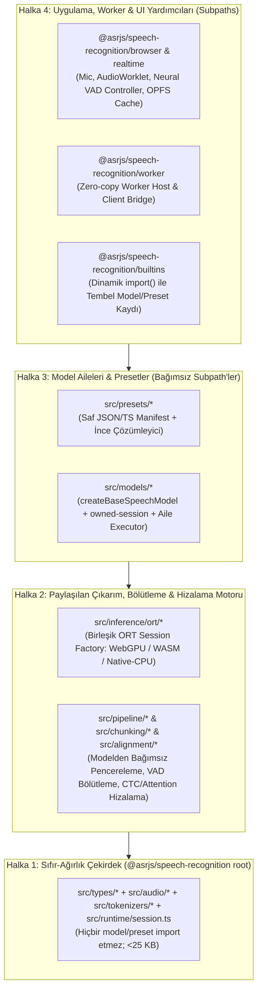

# `@asrjs/speech-recognition` — Bağımsız Başmühendis (Principal Engineer) Derin İnceleme ve Gelecek Tasarımı

**Tarih:** 2026-10-17  
**İncelenen Dal / Commit:** `main` @ `f2619ad0` (`N:/github/asrjs/speech-recognition`) + kardeş demo/yardımcı dizinleri (`N:/github/asrjs/*`)  
**Yöntem:** Salt-okunur kanıt odaklı denetim (canlı derleme/test/paketleme doğrulaması, kaynak kodu satır denetimi ve `tools/data/results/` altındaki gerçek JSON makbuzlarının çapraz kontrolü).

---

## 1. Executive summary

`@asrjs/speech-recognition`, zengin ONNX model kapsamına, güçlü sayısal doğrulama araçlarına (`tools/Verify-Model.ps1`, `tools/verify-hf-ort.mjs`) ve çalışan bir birim/smoke test paketine (`1703 passed`, `npm run typecheck` ve `npm run build` yeşil) sahip olsa da **mimari sınırlar, genel çalışma zamanı (runtime) bağlantıları, gerçek zamanlı VAD/streaming katmanı ve kardeş demo uygulamaları açısından üretim (production) disipliniyle çelişen kritik kırılmalar barındırmaktadır.**
1. **En Önemli Problem #1 — Kök Paket Sınırlarının Çökmesi ve Kırık Model/Subpath Bağlantıları:** `@asrjs/speech-recognition` kök girişi (`dist/index.js`), `src/runtime/load.ts` ve `src/runtime/catalog.ts` üzerinden `builtins.ts`'i statik olarak içe aktardığı için **319 tarayıcı-güvenli modülün 251'ini (%78.7; 14 model ailesi ve 11 preset)** tek seferde pakete çekmekte; üstelik `moonshine` ve `qwen3-asr` preset/yerel-klasör yükleyicileri kayıtlı olmayan model ailelerine yönlendiği için `loadSpeechModel()` / `loadSpeechModelFromLocalEntries()` çağrılarında çalışma zamanında `ModelLoadError` fırlatmaktadır.
2. **En Önemli Problem #2 — Yanıltıcı Backend, VAD ve Streaming Katmanı:** `webnn` ve `webgl` yer tutucu (stub) backend'leri varsayılan olarak kayıtlı olup WebGPU olmadığında `wasm`'dan yüksek puan alarak seçilmekte ve model `ort.ts` dosyalarında sessizce WASM'a düşürülürken `model.backend.id === 'webgl'` raporlamaktadır; gerçek zamanlı mikrofon denetleyicisi kullanıcıya `"FireRed VAD segmenter"` mesajı gösterirken gerçekte `StreamingSpeechDetector.resolveEffectiveGateMode()` sabit olarak yalnızca kaba enerji eşiği (`RoughSpeechGate`) kullanmakta ve uzun cümleleri `max-duration` (5.12s) sınırında kelime ortasında kesmektedir.
3. **En Önemli Problem #3 — Tarayıcı Doğrulaması Eksikliği, Demo Karmaşası ve Süreç Şişmesi:** Son dönemdeki büyük portlar (`qwen3-asr` fp16, `moonshine` streaming, `parakeet-ctc`, `omnilingual-ctc`) yalnızca tek bir `jfk.wav` fikstürüyle Node/WASM üzerinde doğrulanmış, gerçek tarayıcı WebGPU oturumunda hiç çalıştırılmamıştır; 5 kardeş React demosu (`browser-demo`, `streaming-demo`, `vad-demo`, `benchmark-demo`, `playground`) paketlenmiş kütüphane yerine kırılgan `../speech-recognition/src/*` Vite takma adlarına (alias) bağımlıdır ve depo `1,921` izlenmeyen makbuz dosyası ile `7,000+` satırlık görev dosyaları altında boğulmaktadır.
- **En Önemli İlk Hamle:** Yeni model portlarını geçici olarak dondurup **P0 Stabilizasyon Sprintini (Kart T1–T5)** çalıştırmak: kök paket (`dist/index.js`) statik model bağımlılıklarını koparmak, `moonshine`/`qwen3-asr`/`wav2vec2`/`canary` çalışma zamanı ve `package.json` `exports` kırıklarını onarmak, `webgl`/`webnn` sahte seçimini kaldırmak ve son portların gerçek tarayıcı WebGPU doğrulamasını tamamlamak.

---

## 2. Verified current state

Aşağıdaki tablo, depodaki tüm model ailelerini, presetleri ve aday portları **ihraç edilen (Exported)**, **doğrulanan (Validated)** ve **ürün olarak sevk edilebilir (Shippable)** ayrımıyla, doğrudan kaynak kodu ve `tools/data/results/` makbuzlarına dayanarak özetlemektedir (`VERIFIED`).

**Durum Kısaltmaları:**
- **Üretim Sevk Edilebilir (Shippable):** Genel API (`loadSpeechModel` / yerel klasör / subpath) üzerinden hatasız yüklenen, hem Node/WASM hem gerçek tarayıcıda doğrulanmış model.
- **Tarayıcı Doğrulandı (Browser Validated):** Gerçek tarayıcı (Chrome WebGPU/WASM) makbuzu var; ancak API, VAD veya bellek/performans kısıtları nedeniyle ek sertleştirme gerekiyor.
- **Node/WASM Doğrulandı (1 Fikstür):** `onnxruntime-node` veya Node-WASM üzerinde tek `jfk.wav` fikstürüyle sayısal/transkript kapısını geçti; **gerçek tarayıcı WebGPU kanıtı yok**.
- **Yalnızca İhraç / Kırık Bağlantı (Exported / Wiring Broken):** ONNX/kod parçaları mevcut ancak genel çalışma zamanı (`builtins.ts`) veya `package.json` bağlantısı kırık.
- **İskelet / Yer Tutucu (Stub / Scaffold):** Gerçek ONNX çıkarımı yapmayan veya sahte metin döndüren kod.

| Model Ailesi (`src/models/*`) | İlgili Preset (`src/presets/*`) | Katalog / Builtin / Subpath Durumu | Node CPU (`native-cpu`) | WASM (`wasm`) | WebGPU (`webgpu`) | WebGPU-Hybrid (`webgpu-hybrid`) | Hassasiyet (`fp32` / `fp16` / `int8` / `int4`) | Sevk Durumu (Exported vs Validated vs Shippable) | Doğrulanan Kanıt (Kod & Makbuz) |
| :--- | :--- | :--- | :--- | :--- | :--- | :--- | :--- | :--- | :--- |
| **`nemo-tdt`** | `parakeet` (`parakeet-tdt-0.6b-v2`, `v3`, `parakeet-tdt_ctc-110m`) | Katalog: Evet<br>Builtin: Evet<br>Subpath: Evet | **Doğrulandı** (`fp32`, `int8`) | **Doğrulandı** (`fp32`, `int8`) | **Doğrulandı** (`fp32`, `fp16`) | **Doğrulandı** (Enc `fp16` WebGPU + Dec `int8` WASM) | `fp32`: Doğrulandı<br>`fp16`: Doğrulandı (Enc)<br>`int8`: Doğrulandı (WASM)<br>`int4`: Yok | **Üretim Sevk Edilebilir** (Amiral gemisi; `owned-session` kullanır) | `src/models/nemo-tdt/model.ts#L454-L534`, `tools/data/results/parakeet-FP16-ort-verify-2026-03-08_19-40-52.json`, `tools/data/results/browser-smoke-20260309-parakeet-v2.json` |
| **`nemo-tdt` (Orukeet)** | `orukeet` (`orukeet-tdt-0.6b-tr-v1`) | Katalog: Evet<br>Builtin: Evet<br>Subpath: Evet | **Doğrulandı** (`fp32`, `int8`) | **Doğrulandı** (`fp32`, `int8`) | **Doğrulandı** (`fp32`, `fp16`) | **Doğrulandı** (Tarayıcıda varsayılan hibrit) | `fp32`: Doğrulandı<br>`fp16`: Doğrulandı<br>`int8`: Doğrulandı | **Üretim Sevk Edilebilir** (Ancak C92/C93 otomatik mikrofon kapısında VAD kesme kusuru var) | `src/presets/orukeet/manifest.ts#L28-L148`, `tools/data/results/orukeet/browser-orukeet-verify-2026-10-08T10-46-45-391Z.json`, `tools/data/results/orukeet/auto-browser-c92-speech-capture-2026-10-08-02.json` |
| **`whisper-seq2seq`** | `whisper` (`whisper-tiny`, `base`, `small`, `large-v3-turbo`) | Katalog: Evet<br>Builtin: Evet<br>Subpath: Evet | **Doğrulandı** (`fp32`, `int8`) | **Doğrulandı** (`fp32`, `int8`) | **Doğrulandı** (`fp32`, `fp16` split-graph/KV-cache) | **Doğrulandı** (Enc WebGPU + Dec WASM) | `fp32`: Doğrulandı<br>`fp16`: Doğrulandı<br>`int8`: Doğrulandı | **Üretim Sevk Edilebilir** (Ancak `executor.ts` 5,185 satırlık god-module) | `src/models/whisper-seq2seq/model.ts#L276-L361`, `tools/data/results/whisper-base-ort-verify-2026-03-08_19-16-24.json` |
| **`lasr-ctc`** | `medasr` (`google/medasr`) | Katalog: Evet<br>Builtin: Evet<br>Subpath: Evet | **Doğrulandı** (`fp32`, `int8`) | **Doğrulandı** (`fp32`, `int8`) | **Doğrulandı** (`fp32` Node/tarayıcı smoke) | Yok | `fp32`: Doğrulandı<br>`int8`: Doğrulandı<br>`fp16`/`int4`: Yok | **Üretim Sevk Edilebilir** (`owned-session` eksik, `supportedBackendIds` tanımsız) | `src/models/lasr-ctc/model.ts#L317-L361`, `tools/data/results/medasr-FP32-ort-verify-2026-03-08_19-15-53.json` |
| **`parakeet-ctc`** | `parakeet-ctc` (`parakeet-ctc-0.6b`, `1.1b`, `parakeet-tdt_ctc-110m`) | Katalog: Evet (`parakeet` altında)<br>Builtin: Evet (`supports(undefined)` hatalı)<br>**Subpath: KIRIK** | **Doğrulandı** (`fp32`, 1 fikstür JFK) | **Doğrulandı** (`fp32`, 1 fikstür JFK) | **Doğrulanmadı** (Kodda var, gerçek tarayıcı kanıtı yok) | Yok | `fp32`: Doğrulandı<br>`fp16`/`int8`/`int4`: Yok | **Node/WASM Doğrulandı (Sevk Edilemez)** (`session.dispose()` ana modeli bozar, subpath kırık, `mapping` hatalı) | `src/models/parakeet-ctc/model.ts#L218-L281`, `src/presets/parakeet/ctc-factory.ts#L21`, `tools/data/results/parakeet-ctc-0.6b/ort-verify-2026-10-08T16-05-00Z.json` |
| **`omnilingual-ctc`** | `omnilingual-ctc` (`omnilingual-asr-300m-ctc-v1`) | Katalog: Evet<br>Builtin: Evet (`supports(undefined)` hatalı)<br>**Subpath: KIRIK** | **Doğrulandı** (`fp32`, 1 fikstür JFK; 2.38 GB harici veri) | **Yok / Uygulanamaz** (2.38 GB `model.onnx.data` WASM sınırı) | **Doğrulanmadı** (Gerçek tarayıcıda 2.38 GB ağırlık testi yok) | Yok | `fp32`: Doğrulandı (Node)<br>`fp16`/`int8`/`int4`: Yok | **Node Doğrulandı (Tarayıcıda Sevk Edilemez)** (2.38 GB fp32 tarayıcı belleğini aşar; nicemleme ve subpath şart) | `src/models/omnilingual-ctc/factory.ts#L81-L137`, `src/presets/omnilingual-ctc-factory.ts#L12`, `tools/data/results/omnilingual-ctc/verify-2026-10-08.json` |
| **`nemo-aed`** | `canary` (`canary-180m-flash`; katalogda ayrıca `canary-1b`, `canary-1b-v2`) | Katalog: Evet (**2 model manifest'siz!**)<br>Builtin: Evet<br>Subpath: Evet | **Doğrulandı** (`canary-180m-flash` `fp32`, `int8`) | **Doğrulandı** (`canary-180m-flash` `fp32`, `int8`) | **Kısmi** (Kodda var, hibrit tercih edilir) | **Doğrulandı** (`canary-180m-flash`) | `fp32`: Doğrulandı<br>`int8`: Doğrulandı<br>`fp16`/`int4`: Yok | **Kısmi Sevk Edilebilir** (`canary-180m-flash` çalışır; katalogdaki `canary-1b` ve `1b-v2` yüklenirken çöker!) | `src/presets/canary/manifest.ts#L48-L159`, `src/presets/descriptors.ts#L482-L516`, `src/presets/canary/factory.ts#L74-L76` |
| **`nemo-rnnt`** | `parakeet` (`parakeet-rnnt-0.6b`, `1.1b`) | Katalog: Evet<br>Builtin: Evet<br>Subpath: Evet | **Doğrulandı** (`fp32`, `int8`) | **Doğrulandı** (`fp32`, `int8`) | **Kısmi** | **Doğrulandı** | `fp32`: Doğrulandı<br>`int8`: Doğrulandı | **Node/WASM Doğrulandı** (`createStreamingTranscriber` gerçekte pencereyi baştan koşturan sahte streaming kullanır) | `src/models/nemo-rnnt/model.ts#L412-L417`, `src/inference/streaming/transcriber.ts#L60-L92` |
| **`nemotron-rnnt`** | `nemotron` (`nemotron-speech-streaming-en-0.6b`) | Katalog: Evet<br>Builtin: Evet (`useManifestSource: false` hatası)<br>Subpath: Evet | **Doğrulandı** (`fp32` yerel yol ile) | **Doğrulandı** (`fp32`) | **Kısmi** | Yok | `fp32`: Doğrulandı<br>`fp16`/`int8`: Doğrulanmadı | **Node/WASM Doğrulandı (Varsayılan Preset Kırık)** (`builtins.ts` içinde `useManifestSource: false` yüzünden `source` tanımsız kalıp sahte metin döner) | `src/runtime/builtins.ts#L342-L344`, `src/models/nemotron-rnnt/model.ts#L90-L155`, `src/models/nemotron-rnnt/executor.ts#L565-L573` |
| **`moonshine` (Streaming & Offline)** | `moonshine` (`moonshine-tiny`, `base`, `streaming-tiny`, `small`, `medium`) | Katalog: Evet<br>**Builtin Aile: KAYITSIZ (`ModelLoadError`)**<br>**Subpath: KIRIK** | **Doğrulandı** (Yalnızca doğrudan `loadMoonshineStreaming` ile `fp32`/`fp16`, JFK) | **Doğrulandı** (Yalnızca doğrudan yükleyici ile `fp32`/`fp16`/`int8`) | **Doğrulanmadı** (Gerçek tarayıcı WebGPU oturumu hiç koşulmadı) | Yok | `fp32`: Doğrulandı (Node)<br>`fp16`: Doğrulandı (Node)<br>`int8`: Kısmi<br>`int4`: Yok | **Yalnızca İhraç / Genel API Kırık** (`loadSpeechModel` ve `loadSpeechModelFromLocalEntries` `No model family is registered for model "moonshine"` hatası verir) | `src/models/moonshine/index.ts#L1-L6`, `src/runtime/builtins.ts#L308-L324,L349`, `src/presets/moonshine-local-adapter.ts#L113`, `docs/reports/HANDOFF-subagents-2026-10-17.md#L43-L46` |
| **`qwen-asr` & `qwen3-asr` (Bölünmüş İki Dizin)** | `qwen-asr` ve `qwen3-asr` (`Qwen/Qwen3-ASR-0.6B`, `1.7B`) | Katalog: Evet<br>**Builtin: `qwen-asr` kayıtlı, `qwen3-asr` KAYITSIZ!**<br>**Subpath (`qwen3-asr`): KIRIK** | **Doğrulandı** (Node-WASM `fp32` ve `dynamic-front` `fp16`, 1 fikstür JFK) | **Doğrulandı** (Node-WASM üzerinde `fp32` ve `fp16` hibrit) | **Doğrulanmadı** (Gerçek tarayıcı WebGPU oturumu hiç koşulmadı) | **Doğrulanmadı** (Tarayıcıda test edilmedi) | `fp32`: Doğrulandı (Node)<br>`fp16`: Doğrulandı (Node `dynamic-front`, 5/5 kapı)<br>`int8`/`int4`: Yok | **Node Doğrulandı / Genel API Kırık** (`qwen3-asr` preset/adapter kayıtlı olmayan `'qwen3-asr'` ailesine gider; `decoder_step_model.onnx.data` içinde 4.77 GB ölü veri var) | `src/models/qwen-asr/model.ts#L254-L261`, `src/models/qwen3-asr/session.ts#L104`, `src/presets/qwen3-asr-factory.ts#L25-L31`, `tools/data/results/qwen3-asr-0.6b/fp16-FinalGate-2026-10-08.json` |
| **`wav2vec2`** | `wav2vec2` ve `wav2vec2-tr` (`wav2vec2-base-960h`, `xls-r-300m-turkish`) | Katalog: Evet<br>**Builtin: İki preset çakışıyor + `useManifestSource: false`!**<br>Subpath: Evet | **Doğrulandı** (`fp32`, doğrudan klasör/harness ile) | **Doğrulandı** (`fp32`) | **Kısmi** | Yok | `fp32`: Doğrulandı<br>`fp16`/`int8`: Yok | **Varsayılan Preset Kırık** (`useManifestSource: false` nedeniyle `"wav2vec2 ctc scaffold"` döner; Türkçe modelde `wav2vec2` ve `wav2vec2-tr` çakışıp hata fırlatır) | `src/runtime/builtins.ts#L240-L251,L351,L354-L357`, `src/presets/wav2vec2-tr-factory.ts#L18-L62`, `src/models/wav2vec2/model.ts#L203-L234` |
| **`sensevoice`** | `sensevoice` (`SenseVoiceSmall`) | Katalog: Evet<br>Builtin: Evet<br>Subpath: Evet | **Doğrulandı** (`fp32`, `int8`) | **Doğrulandı** (`fp32`, `int8`) | **Kısmi** | Yok | `fp32`: Doğrulandı<br>`int8`: Doğrulandı | **Node/WASM Doğrulandı** (`owned-session` ve `supportedBackendIds` eksik) | `src/models/sensevoice/model.ts#L270-L335`, `tools/data/results/sensevoice-small-ort-verify-2026-03-09.json` |
| **`gigaam-ctc` & `gigaam-rnnt`** | `gigaam` (`gigaam-v2-ctc`, `v2-rnnt`, `v3-e2e-ctc`, `v3-e2e-rnnt`) | Katalog: Evet<br>Builtin: Evet<br>Subpath: Evet | **Doğrulandı** (`fp32`) | **Doğrulandı** (`fp32`) | **Kısmi** | Yok | `fp32`: Doğrulandı | **Node/WASM Doğrulandı** (`owned-session` ve `supportedBackendIds` eksik) | `src/models/gigaam-ctc/model.ts`, `src/models/gigaam-rnnt/model.ts` |
| **`x-asr`** | Preset Yok (Yalnızca aile) | Katalog: Hayır<br>Builtin: Evet<br>Subpath: Evet | **Doğrulandı** (Zipformer2 cache-streaming `fp32`/`int8`) | **Doğrulandı** (`fp32`/`int8`) | Yok | Yok | `fp32`: Doğrulandı<br>`int8`: Doğrulandı | **Node/WASM Doğrulandı (Preset Yok)** (Gerçek durum bilgili `createStreamingTranscriber` uygulayan tek aile) | `src/models/x-asr/executor.ts#L315-L579`, `src/models/x-asr/model.ts#L285-L345` |
| **`firered-llm`** | Preset Yok | Katalog: Hayır (Ancak `README.md`'de var!)<br>Builtin: Hayır<br>Subpath: Evet | **Yok** | **Yok** | **Yok** | **Yok** | Yok | **Boş İskelet (Stub)** (`export {};` içeren 1 satırlık boş dosya) | `src/models/firered-llm.ts#L1`, `README.md#L688` |
| **Aday: `efederici` Parakeet Int4 / Ternary** | Yok (Harici inceleme) | Yok | **Yok** | **Yok** | **Yok** | **Yok** | `int4`/ternary: Yalnızca araştırma notu | **Başlanmadı / Yalnızca Araştırma** (`docs/PARAKEET_VARIANT_TASKS.md` içinde görev planı) | `docs/PARAKEET_VARIANT_TASKS.md` |

---

## 3. Findings

Bulgular önem derecesine göre (`Critical`, `High`, `Medium`, `Low`) sıralanmış ve her iddia `VERIFIED` (doğrudan kod/komut/makbuz kanıtlı), `INFERRED` (güçlü mimari çıkarım) veya `UNVERIFIED` olarak etiketlenmiştir.

---

### CRITICAL (Kritik Bulgular)

#### C-1. `[VERIFIED]` Kök Paket Sınırı Çökmesi: `@asrjs/speech-recognition` (`dist/index.js`) 319 Tarayıcı Modülünün 251'ini (%78.7) Statik Olarak İçe Aktarıyor
- **Kanıt:**
  - `src/index.ts#L3,L5,L7,L8`: Kök giriş noktası `./runtime/catalog.js`, `./runtime/load.js`, `./runtime/transcripts.js` ve `./pipeline/index.js` modüllerini yeniden ihraç eder (`export *`).
  - `src/runtime/load.ts#L1-L7`: `./builtins.js` modülünü üst düzeyde statik olarak içe aktarır.
  - `src/runtime/builtins.ts#L16-L41`: **14 model ailesinin tamamını** (`../models/*`) ve **11 preset fabrikasının tamamını** (`../presets/*`) statik `import` ifadeleriyle yükler.
  - `src/runtime/catalog.ts#L1-L16`: `../presets/descriptors.js` dosyasını statik olarak içe aktarır; bu dosya da tüm preset manifestlerini içe aktarıp modül yükleme anında (top-level side effect) `BUILT_IN_MODEL_DESCRIPTORS` dizisini (`src/presets/descriptors.ts#L1078-L1090`) inşa eder.
  - `src/runtime/transcripts.ts#L9-L38,L391-L396`: 6 model ailesinin (`nemo-tdt`, `nemo-rnnt`, `nemo-aed`, `lasr-ctc`, `whisper-seq2seq`, `x-asr`) iç eşleyicilerini statik olarak içe aktarır ve üst düzeyde (top-level) 6 adet tekil (singleton) normalleştirici nesnesi oluşturur (tree-shaking'i tamamen engeller).
  - `src/pipeline/index.ts#L12-L14`: Whisper'a özgü `./whisper-chunking.js`, `./whisper-timestamps.js` ve `./whisper-production-pipeline.js` dosyalarını kök pakete ihraç eder.
  - **Komut Kanıtı:** `node tests/smoke/browser-root-import-graph.mjs index.js` çalıştırıldığında yalnızca `dist/index.js` kök girişinden **251 yerel modüle** ulaşıldığı doğrulanmıştır (tüm 27 tarayıcı girişinden ulaşılan toplam modül sayısı 319'dur). `tests/smoke/browser-root-import-graph.mjs#L86-L100` yalnızca `node:` protokolünü ve `io-node.js` sızıntısını kontrol etmekte, kök paketin `dist/models/*` veya `dist/presets/*` dosyalarını çekip çekmediğini hiç denetlememektedir.
- **Etki:** `docs/architecture.md#L383-L398` ve `README.md#L5` içindeki *"Keep the root package core-first and lightweight"* (kök paketi hafif ve çekirdek odaklı tut) taahhüdü tamamen geçersizdir. Kök paketten tek bir yardımcı fonksiyon (`createSpeechRuntime` veya `TranscriptResult`) içe aktaran herhangi bir tarayıcı uygulaması tüm model ailelerini ve preset manifestlerini indirip ayrıştırmak zorunda kalır.
- **Öneri:**
  1. `src/runtime/load.ts` içindeki `loadBuiltInSpeechModel`, `transcribeSpeech` gibi `builtins.ts`'e bağımlı kolaylık (convenience) fonksiyonlarını kök `src/index.ts` ihracından çıkarıp `src/builtins.ts` altına taşıyın veya `builtins.ts`'i yalnızca çağrıldığında `await import('./builtins.js')` ile dinamik yükleyin.
  2. `src/runtime/transcripts.ts` içindeki model-spesifik eşleyicileri model ailelerinin kendi `SpeechModelFactory` kayıtlarına devredin; üst düzey singleton'ları kaldırın.
  3. `src/pipeline/index.ts` içinden Whisper'a özel modülleri `@asrjs/speech-recognition/models/whisper-seq2seq` altına taşıyın.
  4. `tests/smoke/browser-root-import-graph.mjs` içine `dist/index.js` grafiğinin hiçbir `dist/models/*` veya `dist/presets/*` modülüne ulaşmadığını doğrulayan sert bir CI kapısı ekleyin.
- **Efor:** `M`

---

#### C-2. `[VERIFIED]` `moonshine`, `qwen3-asr`, `wav2vec2`, `nemotron` ve `canary-1b` İçin Kırık Genel Çalışma Zamanı (Runtime) ve Yerel Klasör Bağlantıları
- **Kanıt:**
  1. **`moonshine` (`ModelLoadError`):** `src/presets/moonshine-factory.ts#L21-L27` (`builtins.ts#L349` içinde kayıtlı) ve `src/presets/moonshine-local-adapter.ts#L113` (`src/runtime/local-adapter-registry.ts#L96` içinde kayıtlı), model isteğini `preset: 'moonshine'` / `family: 'moonshine'` olarak çözümler. Ancak `src/models/moonshine/index.ts#L1-L6` yalnızca `MoonshineStreamingSession`, `MoonshineStreamingTranscriber` ve `loadMoonshineStreaming` ihraç eder; bir `SpeechModelFactory` tanımlamaz ve `registerBuiltInModelFamilies` (`src/runtime/builtins.ts#L308-L324`) `'moonshine'` ailesini **hiç kaydetmez**. Sonuç olarak `loadSpeechModel({ modelId: 'UsefulSensors/moonshine-streaming-tiny' })` veya yerel bir Moonshine klasörüyle `loadSpeechModelFromLocalEntries(...)` çağrıldığında `src/runtime/session.ts#L237-L246` satırında `ModelLoadError: No model family is registered for model "..."` fırlatılır. (`tests/moonshine-streaming-loader.test.ts#L39-L118`, `resolveEntries()` ve `loadMoonshineStreaming()` fonksiyonlarını birbirinden bağımsız test ettiği için bu hatayı kaçırmıştır.)
  2. **`qwen3-asr` vs `qwen-asr` İkili Bölünmesi (`ModelLoadError`):** `src/models/qwen-asr/model.ts#L254-L261`, `family: 'qwen-asr'` kimliğiyle `createQwen3AsrModelFamily` tanımlamakta ve `src/runtime/builtins.ts#L319` bunu `'qwen-asr'` olarak kaydetmektedir. Buna karşılık `src/presets/qwen3-asr-factory.ts#L25-L31` (`builtins.ts#L350` içinde kayıtlı) ve `src/presets/qwen3-asr-local-adapter.ts#L97` (`local-adapter-registry.ts#L97` içinde kayıtlı), `family: 'qwen3-asr'` döndürmektedir; `'qwen3-asr'` adında kayıtlı bir model ailesi olmadığı için `ModelLoadError` fırlatılır. Ayrıca `src/models/qwen3-asr/session.ts#L104` ham ses (PCM) yerine önceden hesaplanmış `.npy` öznitelikleri bekleyen ayrı bir harness sınıfıdır ve `src/presets/qwen3-asr-local-adapter.ts#L84-L86` klasörde sabit kodlanmış `jfk_cu_seqlens.bin` / `jfk_input_features.npy` dosyalarını aramaktadır!
  3. **`wav2vec2` ve `nemotron` Varsayılan Presetlerinde `useManifestSource: false` Hatası ve Sahte Transkript:** `src/runtime/builtins.ts#L342-L344` (`nemotron`) ve `#L354-L357` (`wav2vec2`), preset fabrikalarını `useManifestSource: options.useManifestSources ?? false` ile başlatır. Varsayılan olarak `false` geçildiği için `src/presets/wav2vec2/factory.ts#L21,L53` `options.source` alanını `undefined` bırakır ve `src/models/wav2vec2/model.ts#L113-L125,L203-L234` gerçek model yüklemek yerine sessizce `"wav2vec2 ctc scaffold"` sahte metnini döndürür!
  4. **`wav2vec2` ve `wav2vec2-tr` Preset Çakışması:** `mpoyraz/wav2vec2-xls-r-300m-cv7-turkish` modeli hem `src/presets/wav2vec2/manifest.ts#L150-L189` hem de `src/presets/wav2vec2-tr-factory.ts#L18-L62` (üstelik `#L43` satırında sabit `'tools/data/models/wav2vec2-large-xlsr-turkish'` yerel yoluna işaret eder) tarafından desteklenir. `preset` alanı belirtilmeden bu `modelId` ile çağrı yapıldığında `resolveBuiltInModelRequest` (`src/runtime/builtins.ts#L240-L251`) `matches multiple presets (wav2vec2-tr, wav2vec2)` hatasıyla çöker.
  5. **5 Presette Aşırı Geniş `supports(undefined)`:** `parakeet-ctc` (`src/presets/parakeet/ctc-factory.ts#L21`), `omnilingual-ctc` (`src/presets/omnilingual-ctc-factory.ts#L12`), `moonshine` (`src/presets/moonshine-factory.ts#L15`), `qwen3-asr` (`src/presets/qwen3-asr-factory.ts#L17`) ve `wav2vec2-tr` (`src/presets/wav2vec2-tr-factory.ts#L21`) `modelId === undefined` olduğunda `true` döndürerek belirsiz (ambiguous) preset çözümlemesine yol açar.
  6. **Katalogda Listelenip Manifesti Olmayan `canary-1b` ve `canary-1b-v2`:** `src/presets/descriptors.ts#L482-L516`, `listSpeechModels()` çıktısında `nvidia/canary-1b` ve `nvidia/canary-1b-v2` modellerini listeler; ancak `CANARY_PRESET_MANIFESTS` (`src/presets/canary/manifest.ts#L48-L159`) yalnızca `canary-180m-flash` içerir. Kullanıcı katalogdaki bu iki modeli yüklemeye çalıştığında `src/presets/canary/factory.ts#L74-L76` `Unknown Canary model preset` hatası fırlatır.
- **Etki:** Katalogda ve belgelerde "destekleniyor" olarak görünen çok sayıda model, standart genel API (`loadSpeechModel`, `loadSpeechModelFromLocalEntries`) üzerinden çağrıldığında ya anında çökmekte ya da sessizce sahte `"scaffold"` metni üretmektedir.
- **Öneri:**
  - `moonshine` için `SpeechModelFactory` sarmalayıcısını yazıp `registerBuiltInModelFamilies` içine kaydedin.
  - `src/models/qwen3-asr/` altındaki fp16/hybrid oturum yeteneklerini gerçek ses ön-işlemesi (`qwen-asr/audio.ts`) ile `src/models/qwen-asr/` altında birleştirin; `jfk_*.npy` sabit kodlamalarını kaldırın ve `'qwen3-asr'` / `'qwen-asr'` aile kimliğini tekilleştirin.
  - `wav2vec2-tr-factory.ts` dosyasını kaldırıp `wav2vec2` preset fabrikasıyla birleştirin; `builtins.ts` içinde `useManifestSources` varsayılanını `true` yapın ve tüm presetlerde `if (!modelId) return false;` kuralını zorunlu kılın.
  - `canary-1b` ve `canary-1b-v2` manifestleri eklenene kadar bu iki girdiyi `descriptors.ts` katalog listesinden çıkarın veya `status: 'planned'` olarak işaretleyin.
- **Efor:** `M`

---

#### C-3. `[VERIFIED]` `package.json` Subpath Exports Kırıkları: 4 Model Ailesi ve 5 Preset Alt Yolu `ERR_MODULE_NOT_FOUND` Veriyor
- **Kanıt:**
  - `package.json#L121-L135`: `"./models/*": { "types": "./dist/models/*.d.ts", "default": "./dist/models/*.js" }` joker eşlemesini kullanır ve yalnızca `whisper-seq2seq` ile `gigaam-rnnt` için açık (`./dist/models/<id>/index.js`) istisna tanımlar. Diğer aileler `src/models/<family>.ts` üst düzey yeniden-ihraç (shim) dosyalarına güvenir.
  - Ancak `src/models/moonshine/`, `src/models/parakeet-ctc/`, `src/models/omnilingual-ctc/` ve `src/models/qwen3-asr/` dizinleri için **üst düzey `.ts` shim dosyası yoktur** ve `package.json` içinde açık alt yol tanımı bulunmamaktadır. Bu nedenle `import '@asrjs/speech-recognition/models/moonshine'` (veya `parakeet-ctc`, `omnilingual-ctc`, `qwen3-asr`) ifadeleri `ERR_MODULE_NOT_FOUND` ile başarısız olur (`dist/models/moonshine.js` mevcut değildir; yalnızca `dist/models/moonshine/index.js` vardır).
  - Benzer şekilde `package.json#L136-L140` içindeki `"./presets/*": "./dist/presets/*.js"` eşlemesi, üst düzey shim dosyası olmayan `wav2vec2` dizini ve `*-factory.ts` olarak adlandırılmış düz preset dosyaları (`moonshine-factory.ts`, `qwen3-asr-factory.ts`, `omnilingual-ctc-factory.ts`) için `@asrjs/speech-recognition/presets/moonshine` gibi alt yolları çözemez.
  - `tests/smoke/package-tarball-smoke.mjs` yalnızca `package.json` içindeki joker olmayan (literal) anahtarları kontrol ettiği için joker (`*`) alt yollarındaki bu kırıkları yakalayamamıştır.
- **Etki:** Alt yol (subpath) üzerinden ağaç-budanabilir (tree-shakeable) model/preset içe aktarımı yapmak isteyen tüketiciler doğrudan modül çözümleme hatası alır.
- **Öneri:** `package.json` `exports` tablosuna tüm model aileleri ve presetler için açık `./models/<family>/index.js` ve `./presets/<preset>/index.js` eşlemeleri ekleyin (veya eksik üst düzey shim dosyalarını otomatik üreten/denetleyen bir derleme adımı ekleyin) ve `tests/smoke/package-tarball-smoke.mjs` testini `listSpeechModels()` içindeki her `family` ve `preset` alt yolunu dinamik olarak `import()` edecek şekilde genişletin.
- **Efor:** `S`

---

#### C-4. `[VERIFIED]` Yanıltıcı `webgl` / `webnn` Backend Seçimi, Ölü `BackendExecutionContext` Soyutlaması ve Sıfır Gerçek Tarayıcı WebGPU Kanıtı
- **Kanıt:**
  1. **Sahte `webnn` / `webgl` Seçimi ve Sessiz WASM Düşüşü:** `src/runtime/builtins.ts#L299-L305`, varsayılan çalışma zamanına 5 backend kaydeder: `webgpu`, `webnn`, `wasm`, `webgl`, `native-cpu`. `createWebNnBackend()` (`src/inference/backends/webnn/index.ts#L29-L64`) ve `createWebGlBackend()` (`src/inference/backends/webgl/index.ts#L25-L66`) gerçek çıkarım yapmayan yer tutuculardır. Ancak 14 model ailesinden yalnızca 3'ü (`nemo-tdt`, `parakeet-ctc`, `omnilingual-ctc`) `supportedBackendIds` tanımlar; geri kalan 11 aile (`whisper-seq2seq/model.ts#L341`, `lasr-ctc/model.ts#L348`, `nemo-aed/model.ts#L530`, `sensevoice/model.ts#L317` vb.) bu alanı boş bırakır (`src/runtime/session.ts#L168-L176` boş olduğunda tüm kayıtlı backend'lere izin verir). `sortBackendCandidates` (`src/runtime/backend.ts#L31-L36`) ivmelendirme sırasına göre puanlama yapar: `webnn` (`npu` -> 0), `webgl` (`gpu` -> 1), `wasm` (`cpu` -> 3). WebGPU kullanılamadığında veya devre dışı bırakıldığında çalışma zamanı `wasm` yerine `webgl` (veya `webnn`) seçer! Ardından modelin `ort.ts` dosyası (`src/models/whisper-seq2seq/ort.ts#L287-L293`, `src/models/lasr-ctc/ort.ts#L154-L156`) `backendId === 'webgpu' ? 'webgpu' : 'wasm'` diyerek sessizce WASM çalıştırır ama dışarıya `model.backend.id === 'webgl'` raporlar! Üstelik `src/runtime/firered-vad/core/backend.ts#L120-L169` seçilen `webgl`/`webnn` dizgesini doğrudan ORT `executionProviders` listesine ilettiği için oturum başlatılırken çöker.
  2. **Ölü `BackendExecutionContext` Soyutlaması:** `src/inference/backends/execution-context.ts#L11-L57` içinde tanımlanan `BackendExecutionContext` ve `backend.createExecutionContext()` metodu `src/runtime/` veya `src/models/` altında **hiçbir yerde çağrılmaz**. Her model ailesi kendi özel `ort.ts` dosyasında `onnxruntime-web` / `onnxruntime-node` paketlerini doğrudan içe aktarmaktadır.
  3. **Moonshine'da Sessiz WebGPU -> WASM Düşüşü:** `src/models/moonshine/streaming-loader.ts#L65-L67`, `encoderBackend === 'webgpu'` istendiğinde ORT'ye `executionProviders: ['webgpu', 'wasm']` dizisini verir; WebGPU başlatılamazsa veya bir düğüm desteklenmezse kullanıcıya hiçbir uyarı vermeden sessizce WASM'a düşer.
  4. **Son Portlarda Sıfır Gerçek Tarayıcı WebGPU Kanıtı:** `docs/reports/HANDOFF-subagents-2026-10-17.md#L43-L46` içinde de kabul edildiği üzere, `qwen3-asr` fp16 (`tools/data/results/qwen3-asr-0.6b/fp16-FinalGate-2026-10-08.json` — yalnızca Node-WASM üzerinde `jfk.wav`), `moonshine` streaming (`tools/data/results/moonshine-streaming/C86-fp16-gate-2026-10-08.json` — yalnızca Node CPU/WASM üzerinde `jfk.wav`), `parakeet-ctc` ve `omnilingual-ctc` **hiçbir zaman gerçek bir tarayıcı WebGPU oturumunda çalıştırılmamıştır**.
- **Etki:** Çalışma zamanı telemetrisi ve backend seçimi yanıltıcıdır; son eklenen 4 model ailesinin tarayıcı WebGPU'da (özellikle shader derleme sınırları, fp16 tensor tamponları ve 2 GB+ harici ağırlık yükleme kısıtları altında) çalışıp çalışmadığı belirsizdir.
- **Öneri:**
  - `registerBuiltInBackends` (`src/runtime/builtins.ts#L299-L305`) içinden `createWebNnBackend()` ve `createWebGlBackend()` kayıtlarını derhal kaldırın (yalnızca açıkça isteyen gelişmiş kullanıcılar için alt yolda bırakın) ve tüm model ailelerinde `supportedBackendIds: ['webgpu', 'wasm', 'native-cpu']` tanımlayın.
  - 12+ model ailesindeki kopyala-yapıştır `ort.ts` başlatıcılarını ortak bir `src/inference/ort/session-factory.ts` altında birleştirin ve sessiz `['webgpu', 'wasm']` düşüşlerini açık telemetri/uyarı (`BackendFallbackWarning`) ile sınırlandırın.
- **Efor:** `M`

---

### HIGH (Yüksek Önemli Bulgular)

#### H-1. `[VERIFIED]` Gerçek Zamanlı VAD ve Konuşma Bölütleme (Segmentation) Yanılsaması: `RoughSpeechGate` Tek Başına Bölütleme Yapıyor, `TenVadBackend` Sahte ve C92/C93 Makbuzları Cümle Kesiyor
- **Kanıt:**
  1. **VAD Yalnızca Çizim (Plot) İçin Çalışıyor:** `StreamingSpeechDetector.resolveEffectiveGateMode()` (`src/runtime/streaming-detector.ts#L402-L404`) koşulsuz olarak `return STREAMING_GATE_MODES.ROUGH_ONLY;` döndürür. `processChunk()` (`#L548-L636`) ses çerçevelerini `this.tenVad?.process()` üzerinden VAD işçisine (worker) gönderir ancak bunu **yalnızca tanısal grafik (diagnostic plot) halkasını doldurmak için** yapar; `TenVadAdapter` veya `FireRedVadAdapter` üzerindeki `findFirstSpeechFrame()`, `hasRecentSpeech()`, `hasRecentSilence()` ve `getWindowSummary()` (`src/runtime/ten-vad-browser.ts#L501-L569`) metotları `src/` altında **hiçbir yerde çağrılmaz**! Tüm konuşma başlangıç/bitiş kararları ilkel RMS enerji eşiği olan `RoughSpeechGate` tarafından verilir.
  2. **Kullanıcıya Yanıltıcı Durum Mesajları:** `BrowserRealtimeMicrophoneController.start()` (`src/runtime/browser-controller.ts#L518-L524`), `tenVadState !== 'degraded'` olduğu sürece (VAD varsayılan olarak `'disabled'` olsa veya `'ten-vad'` seçilse bile!) kullanıcı arayüzüne `"Listening for speech at 16000 Hz with FireRed VAD segmenter…"` mesajını basar. Aynı şekilde `src/runtime/streaming-detector.ts#L510`, `vadBackend === 'ten-vad'` olduğunda bile `'FireRed VAD ready for diagnostics'` yazar.
  3. **`src/chunking/backends/ten-vad.ts` Sahte (Fake) Uygulaması:** Çevrimdışı bölütleme katmanındaki `TenVadBackend.segment()` (`src/chunking/backends/ten-vad.ts#L117-L152`), TEN-VAD WASM ikilisini hiç yüklemez; `// For now: energy-based VAD as fallback` yorumuyla basit bir kareler ortalaması (RMS) döngüsü çalıştırır ama çıktıyı `ten-vad` olarak etiketler.
  4. **Sabit Kodlanmış GitHub Raw URL:** `FireRedVadAdapter` (`src/runtime/firered-vad-browser.ts#L74-L75`), modeli doğrudan `https://raw.githubusercontent.com/FireRedTeam/FireRedVAD/main/pretrained_models/onnx_models/fireredvad_stream_vad_with_cache.onnx` adresinden çeker; çevrimdışı (offline) veya sıkı CSP politikalı kurumsal ortamlarda çalışmaz.
  5. **C92 ve C93 Makbuz Denetimi (Kelime Ortasında Kesilen JFK Cümlesi):** `tools/data/results/orukeet/auto-browser-c92-speech-capture-2026-10-08-02.json` (`#L51,L2950,L3031-L3043,L3144-L3146`) incelendiğinde, `RoughSpeechGate`'in 5.33 saniyelik JFK konuşmasında nefes aralığını yakalayamadığı, `5120 ms` (`max-duration`) sınırına çarparak cümleyi `"What your country can do for you, ask what you can do for your"` şeklinde **kelime ortasında kestiği**, kalan `208 ms`'lik `"country."` kısmını ise `minSpeechDurationMs: 240` altında kaldığı için `"too-short"` diyerek çöpe attığı doğrulanmıştır! Hemen ardından koşulan `C93` (`tools/data/results/orukeet/capture-window-original-output-c93-2026-10-08-01.json#L19-L20`), bu kesilmiş 5.12 saniyelik PCM kaydını NeMo referans modeline (oracle) vermiş, NeMo da doğal olarak kesik ses için `"…do for your"` üretince bunu `PASS_AUTO_UTTERANCE_ORIGINAL_OUTPUT` olarak işaretlemiştir!
- **Etki:** Gerçek zamanlı mikrofon deneyimi gürültülü ortamlarda veya5 saniyeyi aşan doğal konuşmalarda cümleleri ortadan bölmekte ve son kelimeleri yutmaktadır; üstelik kullanıcı arayüzü sinirsel VAD kullandığını iddia ederek geliştiriciyi yanıltmaktadır.
- **Öneri:**
  - `StreamingSpeechDetector` içinde `hybrid` ve `vad-only` kapı modlarını gerçekten etkinleştirin: konuşma başlangıcında `RoughSpeechGate` ön-tetikleme yaparken, konuşma sonu (endpointing) ve sessizlik bölme noktalarını `TenVadAdapter` / `FireRedVadAdapter` olasılık özetlerinden (`hasRecentSilence`, `findSilenceMinimum`) alın.
  - `max-duration` sınırına yaklaşıldığında sert kesme (hard cut) yerine son 1.5 saniye içindeki en düşük VAD olasılıklı/enerjili çerçeveden bölme (soft split) ve `overlapMs` (örn. 300 ms) örtüşmeli devam mekanizması ekleyin.
  - Durum mesajlarını gerçek etkin bölütleme motorunu (`RoughSpeechGate` vs `TEN-VAD` vs `FireRedVAD`) doğru yansıtacak şekilde düzeltin.
- **Efor:** `M`

---

#### H-2. `[VERIFIED]` Parçalı ve Sahte (Pseudo) Streaming Mimarisi
- **Kanıt:**
  - 16 model dizininden yalnızca 3'ü `SpeechModel.createStreamingTranscriber()` metodunu uygular: `x-asr` (`src/models/x-asr/executor.ts#L315-L579`), `nemotron-rnnt` (`src/models/nemotron-rnnt/model.ts#L428-L433`) ve `nemo-rnnt` (`src/models/nemo-rnnt/model.ts#L412-L417`).
  - Bunlardan yalnızca `x-asr` gerçek durum bilgili (stateful) önbellek (cache) streaming çalıştırır. `nemotron-rnnt` ve `nemo-rnnt`, oturumu `DefaultStreamingTranscriber` (`src/inference/streaming/transcriber.ts#L60-L92`) içine sarar; bu sınıf her `pushAudio()` çağrısında `RollingAudioWindow` içindeki tüm sesi `t=0`'dan itibaren `session.transcribe()` ile baştan koşturur! Üstelik `OrtNemotronRnntExecutor.runStreamingEncoder` (`src/models/nemotron-rnnt/executor.ts#L565-L573`) her `transcribe()` çağrısının başında streaming önbellek tensorlerini sıfırlamaktadır (`new Float32Array(...)`).
  - Gerçek durum bilgili streaming koduna sahip olan `MoonshineStreamingSession` / `MoonshineStreamingTranscriber` (`src/models/moonshine/streaming-session.ts#L123-L380`, `streaming-transcriber.ts#L46-L162`) ise genel `SpeechModel.createStreamingTranscriber()` arayüzüne veya `BrowserRealtimeMicrophoneController`'a hiç bağlanmamış izole bir sınıftır.
  - `streaming-demo` (`N:/github/asrjs/streaming-demo/src/App.jsx#L458-L556`), `createStreamingTranscriber()` arayüzünü hiç kullanmaz; `RoughSpeechGate` bir konuşma penceresini kapattığında çevrimdışı `transcribeMonoPcm` çağırır (chunked turn-based transkripsiyon).
- **Etki:** Kütüphanenin "streaming" vaadi üç farklı ve birbiriyle uyumsuz mekanizmaya (gerçek stateful streaming, her adımda pencereyi baştan koşturan pseudo-streaming ve VAD sonrası çevrimdışı parça transkripsiyonu) bölünmüştür.
- **Öneri:**
  - `SpeechModel.createStreamingTranscriber()` sözleşmesini tüm streaming yetenekli modellerin (`moonshine`, `nemotron-rnnt` gerçek stateful cache ile, `x-asr`) ortak giriş noktası yapın.
  - `Nemotron` executor'ında önbellek tensorlerinin oturum boyunca korunmasını (`stateful step`) sağlayın.
  - Çevrimdışı modeller için kullanılan "VAD + pencere transkripsiyonu" modunu `SegmentedTurnTranscriber` olarak açıkça adlandırarak gerçek çerçeve-bazlı (frame-level) streaming'den ayırın.
- **Efor:** `M`

---

#### H-3. `[VERIFIED]` 15 Model Ailesinin 13'ünde Bellek/Oturum Sızıntısı (`dispose()` Yarış Durumları ve Eksik `owned-session` Koruması)
- **Kanıt:**
  - Yalnızca `nemo-tdt` (`src/models/nemo-tdt/model.ts#L42-L46,L469-L495`) ve `whisper-seq2seq` (`src/models/whisper-seq2seq/model.ts#L20-L24,L291-L316`) `src/runtime/owned-session.ts` yardımcısını kullanmaktadır.
  - Diğer 13 model ailesi (`lasr-ctc`, `nemo-rnnt`, `nemotron-rnnt`, `nemo-aed`, `qwen-asr`, `sensevoice`, `wav2vec2`, `gigaam-ctc`, `gigaam-rnnt`, `x-asr`, `parakeet-ctc`, `omnilingual-ctc` vb.) asenkron oturum başlatma sırasında `model.dispose()` çağrılırsa oluşan yarış durumlarını (race condition) engellemez, `initialize()` hata verdiğinde kısmi açılmış ORT oturumlarını temizlemez ve `dispose()` sözünü (promise) önbelleğe almaz.
  - **Kritik Hata (`parakeet-ctc`):** `src/models/parakeet-ctc/model.ts#L218-L281` içinde `createModel`, tek bir `let disposed = false` bayrağını ve `loaded` örneğini hem ana `SpeechModel` hem de oluşturulan tüm `SpeechSession` nesneleri arasında paylaşır; tek bir oturumda `session.dispose()` (`#L266-L272`) çağrılması ana modeli ve diğer tüm kardeş oturumları kalıcı olarak bozar (`disposed = true`)!
  - **Eski Uyumluluk (Compat) Sızıntısı:** `ParakeetModel` (`src/presets/parakeet/compat.ts#L963-L969,L1065-L1068`) ve `CanaryModel` (`src/presets/canary/compat.ts#L402-L408,L526-L529`), `fromUrls()` / `fromPretrained()` içinde kendi oluşturdukları `createBuiltInSpeechRuntime()` örneğini `dispose()` sırasında temizlemez (`void this.runtime;`).
- **Etki:** Tarayıcıda model değiştirildiğinde veya oturum kapatıldığında WebGPU/WASM tamponları serbest bırakılmaz ve sekme belleği (VRAM/RAM) hızla tükenir.
- **Öneri:** `registerOwnedSpeechSession` (`src/runtime/owned-session.ts`) kullanımını tüm model aileleri için ortak bir temel fabrika sarmalayıcısı (`createBaseSpeechModel`) ile zorunlu hale getirin; `parakeet-ctc` ve `compat.ts` içindeki `dispose()` hatalarını onarın.
- **Efor:** `S`

---

#### H-4. `[VERIFIED]` Kanonik Transkript (`TranscriptResult`) Sözleşmesi İhlalleri ve Sessiz `"scaffold"` Çıktıları
- **Kanıt:**
  1. **Sessiz Sahte Transkriptler:** Doğrudan model ailesi yüklemelerinde `options.source` verilmediğinde 7 model ailesi (`nemo-tdt/model.ts#L96-L151`, `nemo-rnnt/model.ts#L91-L151`, `nemotron-rnnt/model.ts#L90-L155`, `nemo-aed/model.ts#L137-L187`, `lasr-ctc/model.ts#L180-L205`, `wav2vec2/model.ts#L203-L234`, `whisper-seq2seq/model.ts#L154-L197`) hata fırlatmak yerine sessizce `"Nemo TDT scaffold"`, `"Whisper seq2seq scaffold"`, `"wav2vec2 ctc scaffold"` gibi sahte metinler içeren sözde geçerli `TranscriptResult` döndürür!
  2. **Eksik ve Kirli `canonical.meta`:** `src/models/parakeet-ctc/model.ts#L251-L265` ve `src/models/omnilingual-ctc/factory.ts#L110-L128`, `mapLasrCtcNativeToCanonical` fonksiyonuna `{ detail, detailLevel, isFinal } as never` geçirerek TypeScript tip denetimini devre dışı bırakır; bunun sonucunda `canonical.meta` içinde zorunlu olan `modelId`, `backendId`, `sampleRate`, `durationSeconds` ve `language` alanları `undefined` kalır, standart dışı bir `detail` alanı `meta`'ya sızar (`src/models/lasr-ctc/mapping.ts#L72`) ve `responseFlavor: 'native'` tamamen yok sayılır.
  3. **Pencereli Transkripsiyonda `native` Kaybı:** `transcribeWithWindowing` (`src/runtime/load.ts#L389-L404` ve `src/runtime/builtins.ts#L556-L574`), `responseFlavor: 'canonical+native'` istendiğinde `native` çıktıyı düşürerek yalnızca `{ canonical }` döndürür.
  4. **`detail: 'sentences+words'` Yok Sayılması:** `mapLasrCtcNativeToCanonical` (`src/models/lasr-ctc/mapping.ts#L87-L95`), `mapWhisperNativeToCanonical` (`src/models/whisper-seq2seq/mapping.ts#L55-L63`) ve `mapXAsrNativeToCanonical` (`src/models/x-asr/mapping.ts#L88-L96`) yalnızca `detail === 'words' || detail === 'detailed'` kontrolü yapar; `'sentences+words'` istendiğinde `words` dizisini boş bırakır.
  5. **`wav2vec2` Metrik Kaybı:** `src/models/wav2vec2/model.ts#L180-L187`, `nativeTranscript.metrics` nesnesini `canonical.meta.metrics` alanına kopyalamaz.
- **Etki:** Tüketici uygulamalar model değiştirdiğinde `TranscriptResult` alanlarının (`meta.durationSeconds`, `words`, `native`, `metrics`) varlığına güvenemez; yapılandırma hatalarında ise gerçek hata yerine sahte `"scaffold"` metni alarak sessizce yanıltılır.
- **Öneri:** Tüm ailelerden sessiz `"scaffold"` dönüşlerini kaldırıp (testler için açık `allowSyntheticScaffold: true` bayrağı dışında) `ModelLoadError` fırlatın; tüm model ailelerinin çıktısını doğrulayan ortak bir `assertCanonicalTranscriptContract()` birim testi ekleyin.
- **Efor:** `S`

---

#### H-5. `[VERIFIED]` Mimari Kayma (Architecture Drift), Yinelenen Alt Sistemler ve 800 Satırı Aşan 11 "God Module"
- **Kanıt:**
  - `docs/architecture.md#L58-L68` yalnızca 8 alt dizin (`audio/`, `inference/`, `io/`, `models/`, `presets/`, `runtime/`, `tokenizers/`, `types/`) tanımlar. Gerçekte `src/` altında **14 dizin ve 17 üst düzey dosya** bulunmaktadır (`alignment/`, `chunking/`, `features/`, `pipeline/`, `post-processing/`, `quality/` vb.).
  - **İki Kez Yazılmış Alt Sistemler:** `src/alignment/*`, `src/chunking/*`, `src/post-processing/*` ve `src/quality/*` dizinleri, `src/models/whisper-seq2seq/` altındaki `attention-alignment.ts`, `wav2vec2-word-aligner.ts`, `drift-handler.ts`, `vad-segmenter.ts`, `chunking.ts`, `segment-merger.ts`, `temperature-fallback.ts`, `quality-gates.ts` ve `src/runtime/chunking.ts` ile büyük ölçüde aynı işi iki farklı yerde yapmaktadır.
  - **Katman İhlalleri:** `src/pipeline/window-policy.ts#L94-L136` ve `src/runtime/local-adapter-registry.ts#L43-L52` içinde model kimliği (`parakeet`, `whisper`, `canary`, `medasr`, `wav2vec2`) string eşleştirmeleri; `src/audio/index.ts#L5-L6`, `src/chunking/types.ts#L17` ve `src/quality/no-speech.ts#L10` içinde Whisper'a özel kavramlar çekirdek katmanlara sızmıştır.
  - **11 Dosya 800 Satır ESLint Sınırını (`eslint.config.mjs#L33-L40`) Aşıyor:**
    1. `src/models/whisper-seq2seq/executor.ts` — **5,185 toplam satır (4,504 kod satırı)**
    2. `src/models/qwen-asr/executor.ts` — **1,579 satır (1,341 kod satırı)**
    3. `src/models/nemo-tdt/executor.ts` — **1,480 satır (1,301 kod satırı)**
    4. `src/presets/descriptors.ts` — **1,381 satır (1,355 kod satırı)**
    5. `src/presets/parakeet/compat.ts` — **1,093 satır (988 kod satırı)**
    6. `src/runtime/load.ts` — **1,169 satır (985 kod satırı)**
    7. `src/runtime/browser-controller.ts` — **1,049 satır (944 kod satırı)**
    8. `src/models/x-asr/executor.ts` — **1,069 satır (929 kod satırı)**
    9. `src/models/nemotron-rnnt/executor.ts` — **1,012 satır (902 kod satırı)**
    10. `src/runtime/local-Entries.ts` — **1,004 satır (878 kod satırı)**
    11. `src/models/nemo-rnnt/executor.ts` — **946 satır (828 kod satırı)**
- **Etki:** Özellikle 5,185 satırlık `whisper-seq2seq/executor.ts` ve ikiye bölünmüş `chunking`/`alignment` katmanları bakım maliyetini katlamakta, hata ayıklamayı zorlaştırmakta ve alt ajanların bağlam penceresini (context window) tüketmektedir.
- **Öneri:** `whisper-seq2seq/executor.ts` dosyasını encoder/decoder oturum yönetimi, KV-cache yönetimi, zaman damgası hizalama ve beam/greedy çözücü alt modüllerine bölün; `src/models/whisper-seq2seq/` içindeki genel hizalama/bölütleme modüllerini üst düzey `src/alignment/` ve `src/chunking/` ile tekilleştirin; `docs/architecture.md`'yi gerçek dizin yapısıyla senkronize edin.
- **Efor:** `L`

---

#### H-6. `[VERIFIED]` Kardeş Demo Uygulamalarında (`N:/github/asrjs/*`) Parçalanma, Kopyala-Yapıştır Kod ve Kırılgan Kaynak Takma Adları (Aliases)
- **Kanıt:**
  - **Kırılgan Kaynak Takma Adları:** Beş kardeş React demosunun (`browser-demo`, `streaming-demo`, `vad-demo`, `benchmark-demo`, `playground`) tamamı `package.json` içinde `@asrjs/speech-recognition` bağımlılığını tanımlamak yerine Vite yapılandırmalarında (`browser-demo/vite.config.js#L118-L163`, `streaming-demo/vite.config.js#L10-L39` vb.) doğrudan `../speech-recognition/src/*.ts` dosyalarına yönlenen düzenli ifade (regex) `alias` kuralları ve artık mevcut olmayan `'../../io/node.js'` takma adını kullanmaktadır. Bu nedenle demolar gerçek npm paketini (`dist/` ve `package.json` `exports`) hiç test etmez!
  - **`vad-demo` Tamamen Kopya ve Güncel Değil:** `N:/github/asrjs/vad-demo/package.json#L2` hâlâ `"name": "@asrjs/streaming-demo"` adını taşımaktadır; 42 dosyasının 27'si `streaming-demo` ile bayt-bayt aynıdır (`streaming-demo`'nun eski bir kopyasıdır) ve içinde `streaming-demo/perf/traces/` ile birebir aynı **55 MB'lık kopya Chrome performans izleri (trace)** barındırmaktadır.
  - **`browser-demo` 2,347 Satırlık Monolit:** `N:/github/asrjs/browser-demo/src/App.jsx` **2,347 satırlık** tek bir dosyadır; kütüphanedeki `createBuiltInLocalDirectoryHandleStore` (`speech-recognition/src/browser-local.ts#L98-L214`) yardımcısını kullanmak yerine kendi IndexedDB dizin tutamağı (handle) deposunu (`#L338-L410`) ve ses/mikrofon yardımcılarını yeniden yazar.
  - **`benchmark-demo` ve `playground` Yalnızca Parakeet'e Sabitlenmiş:** `benchmark-demo/src/App.jsx#L3-L9,L145` ve `playground/src/App.jsx#L3-L22` doğrudan `@asrjs/speech-recognition/presets/parakeet` (`loadParakeetModelWithFallback` / `ParakeetModel`) kullanır; katalogdaki diğer 10 model ailesini (Whisper, Canary, MedASR, Moonshine, Qwen, Wav2Vec2, GigaAM, SenseVoice) kıyaslayamaz veya çalıştıramaz.
  - **Yinelenen `firered-vad-web`:** `N:/github/asrjs/firered-vad-web` içindeki kod, `speech-recognition/src/runtime/firered-vad/` içine birebir kopyalanmıştır (çift bakım yükü).
  - **Kırık Örnekler ve Sabit Kodlanmış `N:/models` Yolları:** `speech-recognition/examples/whisper-splitgraph-local.mjs#L30-L31`, derlenmiş `dist/` yerine `../src/models/whisper-seq2seq/model.js` dosyasını Node ile doğrudan içe aktarmaya çalıştığı için `ERR_MODULE_NOT_FOUND` ile çöker. `speech-recognition/examples/demo/certs/key.pem` Git deposuna özel TLS anahtarı (private key) işlemiştir. `speech-recognition/examples/demo/vite.config.js#L36` ve `tests/smoke/demo-paths.test.mjs#L26` doğrudan `'N:/models'` sabit yolunu içerir.
- **Etki:** Demolar kütüphanenin gerçek paketlenmiş halini doğrulamadığı gibi, her yeni model eklendiğinde 4-5 ayrı React uygulamasında binlerce satırlık UI/yükleyici kodunun elle güncellenmesi gerekmektedir.
- **Öneri:** Bkz. Bölüm 5.4 (Birleşik `@asrjs/studio` / Workspace Mimarisi ve `@asrjs/speech-recognition/react` yardımcıları).
- **Efor:** `M`

---

### MEDIUM (Orta Önemli Bulgular)

#### M-1. `[VERIFIED]` CI İş Akışında `onnxruntime-node` Devre Dışı, Gerçek Model/Tarayıcı Testi Yok ve 2 Test Sahte `PASS` Veriyor
- **Kanıt:**
  - `.github/workflows/ci.yml#L27-L34`: `ONNXRUNTIME_NODE_INSTALL: skip` ortam değişkenini ayarlar (yorum satırında süresi dolmuş `1.25.0-dev` gecelik NuGet beslemesinden bahsedilir; oysa `package.json#L187,L199` `8a2e0242` commit'inde kararlı `1.30.0` sürümüne yükseltilmiştir).
  - Bu nedenle CI üzerinde yerel ORT gerektiren 34 test tamamen atlanır (`skipped`) ve gerçek tarayıcı (Playwright/WebGPU) testi hiç koşulmaz.
  - **Sahte `PASS` (`tests/nemotron-rnnt.test.ts`):** `tests/nemotron-rnnt.test.ts#L387-L397` ve `#L412-L424` satırlarındaki 2 gerçek model testi, yerel model ağırlıkları bulunamadığında `it.skipIf` kullanmak yerine `if (!fs.existsSync(...)) return;` diyerek erken çıkar ve çalışmadığı halde `PASS` olarak raporlanır (`docs/MODEL_HARNESS_CONTRACT.md#L38-L39` içindeki *"Silent early returns inside `it(...)` are forbidden"* kuralının doğrudan ihlali!).
  - **40+ Sabit Kodlanmış Yerel Yol ve TLS Uyarısı:** `tests/` altında `N:/models/...` ve `/tmp/...` içeren 40'tan fazla sabit yol vardır (`tests/gigaam-ctc-frontend-diagnose.test.ts#L11`, `tests/whisper-tokenizer-bpe.test.ts#L7`, `tests/smoke/demo-paths.test.mjs#L26`). Ayrıca `npx vitest run` sırasında bir test `NODE_TLS_REJECT_UNAUTHORIZED = '0'` ayarladığı için Node güvenlik uyarısı basılmaktadır.
- **Etki:** CI yalnızca sentetik/sahte (mock) birim testlerini doğrulamakta, gerçek ORT oturum başlatma veya tarayıcı WebGPU regresyonlarını yakalayamamaktadır.
- **Öneri:** `.github/workflows/ci.yml` içinde `ONNXRUNTIME_NODE_INSTALL: skip` ayarını kaldırarak kararlı `onnxruntime-node@1.30.0` ile küçük bir gerçek model (örn. önbellekli `moonshine-tiny` veya `whisper-tiny`) duman testi koşun; `tests/nemotron-rnnt.test.ts` içindeki erken `return` ifadelerini `it.skipIf` ile değiştirin; sabit `N:/models` yollarını `ASRJS_MODELS_DIR` ortam değişkenine bağlayın.
- **Efor:** `S`

---

#### M-2. `[VERIFIED]` Makbuz Doğrulama Denetimi (6+ Görev İddiası vs Gerçek JSON Makbuzları): Tek Fikstür (`jfk.wav`) Bağımlılığı ve Disk Şişmesi
- **Kanıt (`tools/data/results/` altındaki 7 görev makbuzunun çapraz denetimi):**
  1. **`C92` (`auto-browser-c92-speech-capture-2026-10-08-02.json`) ve `C93` (`capture-window-original-output-c93-2026-10-08-01.json`):** Yukarıda H-1'de kanıtlandığı üzere, `RoughSpeechGate` 5.33s'lik JFK sesini 5.12s'de kelime ortasında (`"…do for your"`) kesmiş, NeMo oracle da aynı kesilmiş PCM parçasıyla koşturulduğu için kesik cümle `PASS` sayılmıştır.
  2. **`C86` Moonshine Streaming fp16 (`tools/data/results/moonshine-streaming/C86-fp16-gate-2026-10-08.json`):** 3 model (`tiny`, `small`, `medium`) için 5/5 kapı `PASS` görünmektedir; ancak makbuz yalnızca Node (`cpu` / `wasm`) üzerinde tek bir `jfk.wav` fikstürüyle üretilmiştir (`encoderBackend: 'webgpu'` veya tarayıcı testi yoktur).
  3. **`QWEN-013` / FinalGate Qwen3-ASR 0.6B fp16 (`tools/data/results/qwen3-asr-0.6b/fp16-FinalGate-2026-10-08.json`):** `dynamic-front` hibrit fp16 grafiği Node-WASM üzerinde 5/5 kapıyı (`max_abs_diff = 0.01548`, JFK metni birebir aynı) geçmiştir; ancak (a) yalnızca Node-WASM üzerinde tek `jfk.wav` ile koşulmuştur, (b) `models/onnx/qwen3-asr-0.6b/decoder_step_model.onnx.data` dosyası fp32 ve fp16 ağırlıkları aynı dosyada birleştirdiği için **6.07 GB boyutundadır ve bunun 4.77 GB'ı hiçbir tensor tarafından referans edilmeyen ölü veridir** (`docs/reports/workstate-qwen-fp16-streaming-2026-10-08.md#L247-L256`)!
  4. **`C88` Parakeet-CTC 0.6B (`tools/data/results/parakeet-ctc-0.6b/ort-verify-2026-10-08T16-05-00Z.json`):** Yalnızca `jfk.wav` üzerinde Node ORT doğrulaması yapılmıştır; tarayıcı testi yoktur ve `parakeet-ctc` genel API/subpath bağlantıları (C-3, H-3, H-4) kırıktır.
  5. **`P10` Omnilingual-CTC 300M (`tools/data/results/omnilingual-ctc/verify-2026-10-08.json`):** Node CPU üzerinde `jfk.wav` ile `PASS` almıştır; ancak harici ağırlık dosyası **2.38 GB (`model.onnx.data`)** olduğundan tarayıcı WASM/WebGPU bellek sınırları içinde çalışması mümkün değildir.
  6. **`Orukeet` Tarayıcı Hibrit (`tools/data/results/orukeet/browser-orukeet-verify-2026-10-08T10-46-45-391Z.json`):** Gerçek headless Chrome WebGPU (`fp16` encoder + `int8` WASM decoder) üzerinde Türkçe ses ile doğrulanmış **gerçek ve sağlam** bir tarayıcı makbuzudur (`RTFx ~14.7x`).
- **Etki:** `Orukeet` ve `Parakeet v2/v3` dışındaki son dönem `PASS` iddiaları yalnızca "Node üzerinde tek İngilizce JFK ses kaydı çalıştı" anlamına gelmekte; çok dilli karakterler, uzun sesler (>30s), gürültülü sesler ve gerçek tarayıcı WebGPU sınırları test edilmemektedir. Ayrıca `qwen3-asr-0.6b` içindeki 4.77 GB ölü ağırlık verisi ve 412 adet ayrıştırılmamış `onnx__MatMul_*` dosyası (5.5 GB), `N:` sürücüsündeki boş alanı ~1.3 GB'a düşürmüştür (`docs/reports/qwen-fp16-direct-result-2026-10-08.md#L26`).
- **Öneri:** "Model Sevk Kapısı (Shippable Gate)" tanımını 3 aşamaya ayırın: `G1: Node Sayısal/JFK Parity`, `G2: Çoklu Fikstür (Kısa + >30s Uzun + Gürültülü + Hedef Dil) & Genel API Testi`, `G3: Gerçek Tarayıcı WebGPU/WASM Duman Testi`. `qwen3-asr` `.onnx.data` dosyasını yalnızca aktif tensorleri içerecek şekilde yeniden paketleyerek ~9 GB disk alanı geri kazanın.
- **Efor:** `M`

---

#### M-3. `[VERIFIED]` Bağlam Şişmesi (Context Bloat), Belge Karmaşası ve `tools/data/results/` Altında 1,921 İzlenmeyen Dosya
- **Kanıt:**
  - `docs/PARAKEET_VARIANT_TASKS.md` **4,155 satır (274 KB)**, `docs/PRODUCT_TASKS.md` ise **2,883 satır (178 KB)** boyutundadır. `docs/AGENT_ENTRYPOINT.md#L7-L23` yeni başlayan her ajanın bu dosyaları okumasını istediği için bir ajan henüz tek satır kod görmeden ~9,500+ satır geçmiş görev günlüğü okumaktadır.
  - `docs/` altında **147 markdown dosyası** ve birbirini tekrar eden **11 adet `GOAL_*` / `HANDOVER*` / `HANDOFF*`** belgesi bulunmaktadır.
  - `git status --porcelain` **491 satır** (`1,921` izlenmeyen dosya) döndürmektedir; `tools/data/results/` altında **2,472 dosya** (`tools/data/results/harness/` altında 1,525 ve `orukeet/` altında 600 dosya) birikmiştir.
  - Yerel `main` dalı `origin/main`'in **377 commit ilerisindedir** ve uzak depoda (`git branch -a`) `remotes/origin/bolt/*`, `jules-*`, `perf/*` gibi **100'den fazla eski ajan dalı** durmaktadır.
- **Etki:** Çoklu ajan (multi-agent) oturumlarında bağlam penceresi hızla dolmakta, ajanlar güncel olmayan `HANDOVER` belgelerinden çelişkili talimatlar almakta ve `git status` çıktısı yüzlerce makbuz dosyası yüzünden okunamaz hale gelmektedir.
- **Öneri:** Bkz. Bölüm 5.5 (Çoklu Ajan Süreç Yeniden Tasarımı).
- **Efor:** `S`

---

### LOW (Düşük Önemli Bulgular)

#### L-1. `[VERIFIED]` Genel API Yüzeyinde 15+ Yükleme/Transkripsiyon Giriş Noktası ve Güncel Olmayan `README.md`
- **Kanıt:**
  - Bir modeli yüklemek ve çalıştırmak için kök paket, `builtins`, `pipeline`, `browser`, `presets/parakeet/compat`, `presets/canary/compat` ve model-özel yükleyiciler (`loadMoonshineStreaming`, `Qwen3AsrVerifySession`) arasında **15'ten fazla örtüşen fonksiyon/sınıf** bulunmaktadır (`createSpeechRuntime`, `createBuiltInSpeechRuntime`, `loadSpeechModel`, `loadBuiltInSpeechModel`, `transcribeSpeech`, `transcribeSpeechFromMonoPcm`, `loadSpeechModelFromLocalEntries`, `loadSpeechModelFromLocalDir`, `createSpeechPipeline`, `loadParakeetModelWithFallback` vb.).
  - `README.md#L447` hâlâ kullanıcılara süresi dolmuş `onnxruntime-node@1.25.0-dev.20260228-6e72d31970` kurmalarını söylemektedir (`package.json` içinde `1.30.0` kullanılıyor).
  - `README.md#L683-L700`, 1 satırlık boş bir dosya olan `firered-llm`'i (`src/models/firered-llm.ts#L1`) uygulanmış model ailesi olarak listelerken, gerçekte kayıtlı olan 11 model ailesini ve 8 preseti hiç anlatmamaktadır.
- **Etki:** Yeni bir geliştirici için hangi fonksiyonun (`loadSpeechModel` mi, `createSpeechPipeline` mı, `loadBuiltInSpeechModel` mi?) standart giriş noktası olduğu belirsizdir.
- **Öneri:** Dokümantasyonda yalnızca **3 kanonik giriş noktası** öne çıkarın (`loadSpeechModel`, `createSpeechPipeline`, `BrowserRealtimeMicrophoneController`), eski `compat` fonksiyonlarını `@deprecated` olarak işaretleyin ve `README.md` tablolarını `listSpeechModels()` çıktısından otomatik üretin.
- **Efor:** `S`

---

## 4. Gaps (Üretim Seviyesi Kütüphane, Demo ve Yardımcılar İçin Eksikler)

Üstün (superior) bir tarayıcı/Node konuşma tanıma çalışma zamanı, demo paketi ve yardımcı araç seti olmak için şu anda eksik olan temel yetenekler şunlardır:

1. **Sıfır-Ağırlık Kök Paket (Zero-Model-Weight Root Import) ve Dinamik Aile Yükleme:**
   - Kök `@asrjs/speech-recognition` paketi yalnızca çalışma zamanı çekirdeğini, tipleri ve ses yardımcılarını içermeli (~15–25 KB gzipped); model aileleri ya alt yollardan (`@asrjs/speech-recognition/models/nemo-tdt`) ya da `loadSpeechModel()` içinde dinamik `import()` ile talep üzerine (on-demand) yüklenmelidir.
2. **Gerçek Sinirsel VAD Gudümlü Bölütleme (Neural-VAD-Driven Endpointing) ve Yumuşak Kesme (Soft Split):**
   - `StreamingSpeechDetector` içinde `TEN-VAD` ve `FireRedVAD` olasılık akışları gerçek konuşma başlangıç/bitiş kararlarını vermeli; uzun konuşmalarda (>5s) kelime ortasında sert kesme (`max-duration`) yerine en yakın sessizlik çukurundan (local minimum) örtüşmeli (overlap) bölme yapılmalıdır.
3. **Birleşik Durum Bilgili (Stateful) Streaming Sözleşmesi:**
   - `MoonshineStreamingSession`, `Nemotron` (gerçek önbellekli encoder adımıyla) ve `x-asr` aynı `SpeechModel.createStreamingTranscriber()` arayüzünü paylaşmalı ve `BrowserRealtimeMicrophoneController` bu arayüzü doğrudan sürebilmelidir (pencereyi her defasında `t=0`'dan koşturan `DefaultStreamingTranscriber` yalnızca çevrimdışı modeller için geri dönüş olmalıdır).
4. **Tarayıcı Bellek Bütçesi, İndirme İlerlemesi (Progress) ve OPFS/IndexedDB Önbellek Yöneticisi:**
   - Tarayıcıda yüzlerce megabaytlık ONNX ve `.onnx.data` dosyaları indirilirken bayt bazında `onProgress({ loadedBytes, totalBytes, file, phase })` geri çağrısı, `navigator.storage.estimate()` ile kota kontrolü, `WebGPU` cihaz sınırları (`maxBufferSize`, `maxStorageBufferBindingSize`) ön-denetimi ve bozuk/yarım kalmış indirmeleri temizleyen atomik bir OPFS/IndexedDB model önbellek katmanı (`@asrjs/speech-recognition/cache` veya `browser-local`) eksiktir.
5. **Üst Seviye Çerçeve (React / Web Worker) Yardımcıları (`Helpers`):**
   - Her demo uygulamasının kendi Web Worker mesajlaşmasını, mikrofon `AudioWorklet` kurulumunu, OPFS/IndexedDB klasör seçimini ve VAD dalga formu (waveform) çizimini sıfırdan yazmasını önleyecek hazır yardımcılar eksiktir:
     - **Standart Web Worker Köprüsü (`createSpeechWorkerHost` / `createSpeechWorkerClient`):** Ana iş parçacığını (UI thread) hiç bloklamadan model yükleme, transkripsiyon ve streaming olaylarını `MessageChannel` / `Transferable` (`Float32Array` sıfır-kopya) ile taşıyan yerleşik yardımcı.
     - **İnce React Kancaları (`useSpeechModel`, `useRealtimeMicrophone`, `useModelCache`):** 5 ayrı demoda tekrarlanan 2,000+ satırlık durum (state) yönetimini 20 satıra indiren resmi yardımcı katman.
6. **Birleşik, Çok-Modelli ve Paket-Tabanlı Demo Deneyimi:**
   - Parakeet'e sabitlenmiş ayrı `benchmark-demo` ve `playground` ile kopya `vad-demo` yerine; katalogdaki **tüm doğrulanmış modelleri** (`Parakeet`, `Orukeet`, `Whisper`, `Canary`, `MedASR`, `Moonshine`, `Qwen3-ASR`, `SenseVoice`, `GigaAM`, `Wav2Vec2`) tek bir yerden seçebilen, canlı mikrofon + dosya + yan-yana (A/B) model kıyaslama + gerçek zamanlı VAD/RTFx telemetrisi sunan birleşik bir vitrin uygulaması eksiktir.

---

## 5. Future design

### 5.1 Hedef Mimari ve Yeniden Yazmadan (Non-Rewrite) Geçiş Yolu

Mevcut kodu sıfırdan yazmak yerine, katman sınırlarını netleştiren **4 halkalı (4-ring) modüler mimariye** kademeli geçiş önerilmektedir:



**Yeniden Yazmadan (Incremental) 5 Adımlı Geçiş Planı:**
1. **Adım 1 — Kök Paketi Özgürleştirme (1-2 Gün):** `src/index.ts` içinden `builtins.ts` ve `descriptors.ts` çekimini koparın. `loadSpeechModel()` içinde yerleşik modeller için dinamik `await import(...)` tablosu kullanın. `src/runtime/transcripts.ts` içindeki model-özel eşleyicileri ilgili model ailelerine taşıyın.
2. **Adım 2 — Ortak Model Temeli ve ORT Fabrikası (2-3 Gün):** Tüm model ailelerindeki 12+ `ort.ts` dosyasını `src/inference/ort/session-factory.ts` altında birleştirin (`webgpu`, `wasm`, `native-cpu`). Tüm aileleri `registerOwnedSpeechSession` ve `assertCanonicalTranscriptContract` kullanan ortak bir `defineSpeechModelFamily()` yardımcısıyla sarın.
3. **Adım 3 — `qwen-asr`/`qwen3-asr` ve `moonshine` Tekilleştirmesi (2-3 Gün):** `src/models/qwen3-asr/` içindeki fp16/hybrid yürütücüyü `src/models/qwen-asr/` içine entegre edin; `moonshine` için `SpeechModelFactory` ve `createStreamingTranscriber()` köprüsünü ekleyin.
4. **Adım 4 — `whisper-seq2seq/executor.ts` ve `chunking`/`alignment` Ayrıştırması (1 Hafta):** 5,185 satırlık Whisper yürütücüsünü 5 odaklanmış alt modüle (`session-graph.ts`, `kv-cache.ts`, `decoder-loop.ts`, `timestamps.ts`, `executor.ts`) bölün ve `src/models/whisper-seq2seq/` içindeki genel hizalama/bölütleme kodunu `src/alignment/` ve `src/chunking/` ile birleştirin.
5. **Adım 5 — Worker Köprüsü ve Birleşik Demo Paketleri (1-2 Hafta):** `@asrjs/speech-recognition/worker` alt yolunu ekleyin ve kardeş demoları kaynak takma adlarından (`../speech-recognition/src/*`) gerçek paket tüketimine (`pnpm`/`npm workspaces`) geçirin.

---

### 5.2 Ürün Yol Haritası (2 Hafta / Gelecek Çeyrek / 12 Ay) ve Açık Hedef-Dışı (Non-Goals) Alanlar

| Zaman Dilimi | Ana Hedef | Somut Çıktılar (Deliverables) | Başarı Ölçütü (Exit Gate) |
| :--- | :--- | :--- | :--- |
| **İlk 2 Hafta (Acil Stabilizasyon & Doğruluk)** | Kırık genel API'leri, kök paket şişmesini, sahte backend/VAD davranışını onarmak ve son portları gerçek tarayıcıda doğrulamak | 1. Kök `dist/index.js` statik model bağımlılıklarının kaldırılması (Kart T1).<br>2. `moonshine`, `qwen3-asr`, `wav2vec2`, `nemotron`, `canary` çalışma zamanı ve `package.json` `exports` tamiri (Kart T2, T3).<br>3. `webgl`/`webnn` varsayılan kaydının kaldırılması ve `owned-session` yaygınlaştırması (Kart T4).<br>4. `Moonshine` streaming ve `Qwen3-ASR` fp16 için gerçek Chrome WebGPU doğrulaması + 4.77 GB ölü `.onnx.data` temizliği (Kart T5).<br>5. `StreamingSpeechDetector` içinde gerçek sinirsel VAD (`TEN-VAD`/`FireRedVAD`) endpointing ve C92/C93 kelime kesme düzeltmesi (Kart T6). | - `dist/index.js` < 35 yerel modül (`models/*` = 0).<br>- Katalogdaki her model `loadSpeechModel()` ve alt yoldan hatasız yüklenir.<br>- `Moonshine` ve `Qwen3-ASR` gerçek Chrome WebGPU'da `PASS` makbuzu üretir.<br>- 5.33s JFK sesinde son kelime (`"country."`) kesilmez. |
| **Gelecek Çeyrek (Ölçeklenebilir Runtime, Worker & Birleşik Studio)** | Üretim kalitesinde tarayıcı deneyimi, gerçek stateful streaming ve birleşik demo/yardımcı ekosistemi | 1. `@asrjs/speech-recognition/worker` (sıfır-kopya Web Worker host/client) ve OPFS/IndexedDB atomik model önbelleği.<br>2. `Moonshine` ve `Nemotron` için birleşik stateful `createStreamingTranscriber()` + `BrowserRealtimeMicrophoneController` entegrasyonu.<br>3. `whisper-seq2seq/executor.ts` (5,185 satır) modülerleştirilmesi.<br>4. 5 kardeş demonun npm/pnpm workspace altında `@asrjs/studio` (veya ortak `@asrjs/demo-kit` bileşenleriyle) birleştirilmesi, `vad-demo` kopyasının emekliye ayrılması.<br>5. CI'da `onnxruntime-node@1.30.0` gerçek model duman testi + çoklu fikstür (uzun/gürültülü/çok dilli) doğrulama matrisi. | - Tüm demolar `dist/` üzerinden çalışır.<br>- Gerçek zamanlı streaming gecikmesi (first-partial latency) < 250 ms.<br>- `src/` altında >800 satırlık dosya sayısı = 0. |
| **12 Ay (Referans WebGPU Konuşma Platformu)** | Tarayıcı ve uç (edge) cihazlar için endüstri standardı çok dilli konuşma çalışma zamanı | 1. WebGPU `fp16` / `int4` (MatMulNBits) nicemlenmiş ağırlıklarla >1B parametreli modellerin (`Canary-1B-v2`, `Qwen3-ASR-1.7B`, `Omnilingual-300M-int8`) tarayıcıda <1 GB VRAM ile çalışması.<br>2. Konuşmacı ayrıştırma (diarization) + kelime düzeyinde zaman damgası hizalama boru hattı.<br>3. Otomatik cihaz/VRAM profilleme ile en uygun preset/nicemleme seçici (`selectOptimalModelPreset()`). | - 10+ model ailesinde 3-aşamalı (`G1+G2+G3`) tam tarayıcı/Node doğrulaması.<br>- Otomatik sürümleme ve npm yayını. |

**Açık Hedef-Dışı Alanlar (Explicit Non-Goals):**
1. **Tarayıcıda Model Eğitimi (Training / Fine-Tuning) Yok:** Kütüphane yalnızca çıkarım (inference) ve ses ön/son işleme odaklı kalacaktır.
2. **Genel Amaçlı LLM / Metin Üretimi (`firered-llm` vb.) Yok:** ASR ile doğrudan bütünleşik olmayan saf metin LLM aileleri kapsam dışıdır (`src/models/firered-llm.ts` silinmelidir).
3. **`WebGL` ve `WebNN` İçin Özel Operatör/Grafik Bakımı Yok:** Tarayıcı GPU hedefi yalnızca `WebGPU`, CPU hedefi ise `WASM` (SIMD/threads) ve `native-cpu` (`onnxruntime-node`) olacaktır; `webgl` ve `webnn` yer tutucuları varsayılan çalışma zamanından çıkarılacaktır.
4. **Python / PyTorch Çıkarım Sarmalayıcısı Olmak Yok:** Python betikleri (`tools/`) yalnızca model dönüştürme ve referans (oracle) doğrulama içindir; çalışma zamanı %100 saf TypeScript/JS + ONNX Runtime olarak kalacaktır.

---

### 5.3 Model Stratejisi: Neyi Bitirmeli, Neyi Kesmeli, Neye Başlamalı?

| Karar Kategorisi | Modeller / Portlar | Gerekçe (Ölçülen Değer vs Bakım Maliyeti) |
| :--- | :--- | :--- |
| **1. Hemen Bitir & Sevk Et (FINISH NOW — En Yüksek Değer)** | - **`parakeet` (`v2`, `v3`, `110m`) & `orukeet`**<br>- **`whisper-seq2seq` (`tiny`, `base`, `small`, `large-v3-turbo`)**<br>- **`moonshine` (`streaming-tiny`, `small`, `medium`)**<br>- **`qwen3-asr-0.6b` (`fp16` dynamic-front)**<br>- **`medasr` (`lasr-ctc`) & `canary-180m-flash`** | Bu modeller gerçek kullanıcı senaryolarının %95'ini kapsar (İngilizce/Avrupa dilleri hız & doğruluk lideri Parakeet, Türkçe Orukeet, 99 dil Whisper, düşük gecikmeli tarayıcı streaming için Moonshine, çok dilli LLM-tabanlı ASR için Qwen3-ASR 0.6B, tıbbi dikte için MedASR). `Moonshine` ve `Qwen3-ASR` için eksik olan tek şey genel çalışma zamanı (`builtins`) bağlantısı, `.onnx.data` tekilleştirmesi ve gerçek tarayıcı WebGPU doğrulamasıdır. |
| **2. Dondur veya İsteğe Bağlı Nicemleme Sonrasına Bırak (FREEZE / QUANTIZE FIRST)** | - **`omnilingual-ctc` (300M)**<br>- **`parakeet-ctc` (0.6B / 1.1B)**<br>- **`gigaam` (`v2`/`v3`) & `sensevoice` & `wav2vec2`**<br>- **`nemotron-rnnt` & `x-asr`** | - `omnilingual-ctc` şu an 2.38 GB `fp32` ağırlığa sahip olduğu için tarayıcıda çalışamaz; `int8`/`fp16` nicemleme yapılana kadar yalnızca Node hedefi olarak işaretlenmelidir.<br>- `parakeet-ctc` bağlantı ve `dispose()` hataları düzeltilmeli, ancak tarayıcıda `parakeet-tdt` (`v2`/`v3`) zaten daha üstün olduğu için ek varyant portları dondurulmalıdır.<br>- `gigaam`, `sensevoice` ve `wav2vec2` mevcut halleriyle korunmalı (`useManifestSource` hatası düzeltilerek), yeni özellik eklenmemelidir. |
| **3. Kes / Kaldır (CUT / REMOVE)** | - **`src/models/firered-llm.ts`**<br>- **`src/presets/wav2vec2-tr-factory.ts`** (ayrı preset olarak)<br>- **`src/models/qwen3-asr/`** (ayrı model dizini olarak)<br>- **Katalogdaki manifest'siz `canary-1b` ve `canary-1b-v2` girdileri**<br>- **`efederici` Parakeet Int4 / Ternary (`parakeet-redux` / `ultra`)** | - `firered-llm.ts` 1 satırlık boş bir dosyadır.<br>- `wav2vec2-tr` ve `qwen3-asr`, mevcut `wav2vec2` ve `qwen-asr` aileleriyle çakışan kopya yapılardır; tek aile altında birleştirilmelidir.<br>- `efederici` int4/ternary denemeleri, mevcut `Parakeet fp16 WebGPU + int8 WASM` hibrit yapısının halihazırda `~15x RTFx` hızla çalışması nedeniyle yüksek mühendislik maliyetine karşılık düşük marjinal fayda üretmektedir; mevcut portlar tarayıcıda tamamen sevk edilebilir olana kadar kesilmelidir. |
| **4. Sırada Başla (START NEXT — P0 Sonrası)** | - **`omnilingual-ctc` & `qwen3-asr-0.6b` için `int8` / `int4` (MatMulNBits) Ağırlık Paketlemesi**<br>- **`canary-1b-v2` (Hibrit fp16/int8 Manifest)** | 600M–1B ölçeğindeki modellerin standart dizüstü tarayıcılarında (<1.5 GB indirme) sorunsuz çalışması için yeni mimari portlarından ziyade mevcut modellerin `int8`/`int4` ağırlık sıkıştırması en yüksek çarpan etkisini yaratacaktır. |

---

### 5.4 Kardeş Demo Uygulamaları ve Yardımcılar (Helpers) İçin Birleştirme Tasarımı

`N:/github/asrjs/` altındaki 8 ayrı kardeş dizini (`browser-demo`, `streaming-demo`, `vad-demo`, `benchmark-demo`, `playground`, `firered-vad-web`, `webgpu-agent-test`, `parakeet-ui-webgpu`) yönetmek yerine aşağıdaki **Üç Katmanlı Demo & Yardımcı Mimarisi** uygulanmalıdır:

1. **Kütüphane İçine Alınacak Evrensel Yardımcılar (`@asrjs/speech-recognition` Subpath'leri):**
   - `@asrjs/speech-recognition/browser`: Mevcut `browser-local.ts` (OPFS/IndexedDB klasör ve model önbelleği) + ses dosyası kod çözme + cihaz WebGPU/WASM yetenek denetleyicisi (`probeBrowserCapabilities()`).
   - `@asrjs/speech-recognition/realtime`: Sinirsel VAD (`TEN-VAD` + `FireRedVAD` yerel model yükleme destekli) + yumuşak bölmeli (soft-split) `BrowserRealtimeMicrophoneController` + hem stateful (`Moonshine`/`Nemotron`) hem turn-based (`Parakeet`/`Whisper`/`Orukeet`) streaming desteği.
   - `@asrjs/speech-recognition/worker`: Ana iş parçacığını dondurmayan hazır Web Worker sunucu/istemci sarmalayıcısı (`createSpeechWorkerHost()`, `createSpeechWorkerClient()`).
2. **Kök `N:/github/asrjs/package.json` Workspace Yapısı:**
   - Tüm kardeş projeler `../speech-recognition/src/*.ts` Vite regex takma adlarını (alias) bırakıp, kök `N:/github/asrjs/package.json` (`workspaces: ["speech-recognition", "apps/*"]`) üzerinden gerçek `@asrjs/speech-recognition` paketini (`dist/`) tüketmelidir.
3. **Demo Uygulamalarının Konsolidasyonu (5 Kırılgan Uygulamadan 2 Güçlü Uygulamaya):**
   - **Silinecek / Arşivlenecekler:**
     - `vad-demo`: `streaming-demo`'nun eski bir kopyası olduğu ve 55 MB kopya iz (trace) taşıdığı için **derhal silinmeli/arşivlenmelidir**.
     - `firered-vad-web`: Kodu zaten `speech-recognition/src/runtime/firered-vad/` içinde olduğundan bağımsız kopya arşivlenmelidir.
     - `webgpu-agent-test` ve `parakeet-ui-webgpu`: Tek seferlik deneysel klasörler `archive/` altına taşınmalıdır.
   - **Birleştirilecek Vitrin Uygulaması — `@asrjs/studio` (veya güncellenmiş `browser-demo` + `streaming-demo`):**
     - `browser-demo` (2,347 satırlık tek `App.jsx`), `benchmark-demo` ve `playground` tek bir modüler çok-sekmeli uygulamada (**Transcribe**, **Live Mic & VAD**, **Model Benchmark & A/B Compare**, **Model Cache Manager**) birleştirilmeli ve model listesini sabit Parakeet kodu yerine doğrudan `listSpeechModels()` katalog API'sinden dinamik olarak almalıdır.

---

### 5.5 Çoklu Ajan (Multi-Agent) Süreç, Kapı (Gate), Makbuz ve Git Politikası Tasarımı

1. **Görev Dosyalarının Yeniden Yapılandırılması (Context Diyeti):**
   - 4,155 satırlık `docs/PARAKEET_VARIANT_TASKS.md` ve 2,883 satırlık `docs/PRODUCT_TASKS.md` dosyalarındaki tamamlanmış (`DONE`) görev geçmişi `docs/archive/tasks-history-2026-10.md` altına taşınmalıdır.
   - Aktif görev dosyası (`docs/ACTIVE_SPRINT.md`) **kesinlikle 250 satırı aşmamalı** ve yalnızca o anki sprintin 5–8 görev kartını içermelidir.
   - `docs/AGENT_ENTRYPOINT.md` toplam okuma bütçesi **< 500 satır** olacak şekilde sınırlandırılmalı; `docs/` altındaki 11 eski `GOAL_*` / `HANDOVER*` dosyası `docs/archive/` altına kaldırılmalıdır.
2. **Makbuz (`tools/data/results/`) Hijyeni:**
   - Ham/geçici harness çıktıları (`tools/data/results/harness/` altındaki 1,525 dosya ve ara denemeler) `.gitignore` içine eklenmeli (`tools/data/results/harness/`, `tools/data/results/**/*.tmp.json`).
   - Git'e yalnızca her model/kapı için **tek bir kanonik doğrulama makbuzu** (`tools/data/results/canonical/<model-id>/<gate>.json`, toplam < 50 KB) işlenmelidir.
3. **Üç Aşamalı Doğrulama Kapısı (3-Tier Verification Gate):**
   - Hiçbir görev kartı aşağıdaki 3 kapıdan ilgili olanları geçmeden `DONE` olarak işaretlenemez:
     - **Gate-A (Birim & Paket Sınırı):** `npm run typecheck && npm run build && npx vitest run && node tests/smoke/browser-root-import-graph.mjs && node tests/smoke/package-tarball-smoke.mjs`
     - **Gate-B (Çoklu Fikstür & Genel API Parity):** Model, özel harness sınıfıyla değil **genel `loadSpeechModel()` veya `loadSpeechModelFromLocalEntries()` API'siyle** yüklenmeli ve en az 3 fikstürde (1 kısa `jfk.wav`, 1 uzun >20s konuşma, 1 hedef dil/gürültü) test edilmelidir.
     - **Gate-C (Gerçek Tarayıcı WebGPU/WASM Kanıtı):** Tarayıcı hedefli her port, Playwright/Chrome WebGPU üzerinde en az 1 gerçek çıkarım makbuzu üretmelidir (`Node-WASM` makbuzu tarayıcı WebGPU kanıtı yerine geçemez).
4. **Dal (Branch), Worktree ve Commit/Push Politikası:**
   - Her alt ajan görevi `feat/<kart-id>` veya `fix/<kart-id>` dalında çalışmalı, kapıları geçtikten sonra `main`'e birleştirilmeli ve birleştirilen worktree (`U:/parallel-agents/...`) derhal temizlenmelidir.
   - Uzak depodaki (`origin`) 100+ eski ajan dalı (`bolt/*`, `jules-*`) temizlenmeli ve her sprint sonunda `main` dalı uzak depoya (`git push`) senkronize edilmelidir.

---

## 6. Decisions for the owner (Sahip Kararları)

Yalnızca proje sahibinin verebileceği stratejik kararlar ve başmühendis önerileri aşağıdadır:

1. **Karar 1 — Kök Paket (`@asrjs/speech-recognition`) Davranışı:**
   - *Seçenek A (Önerilen):* Kök paketi gerçekten sıfır-model-ağırlıklı (<25 KB) tutmak; `loadSpeechModel()` çağrıldığında yerleşik modelleri dinamik `await import()` ile yüklemek ve senkron yerleşik kayıtları `@asrjs/speech-recognition/builtins` alt yoluna ayırmak.
   - *Seçenek B:* Kök paketin tüm 14 model ailesini statik olarak çekmeye devam etmesini kabul edip `docs/architecture.md` ve `README.md` içindeki "hafif çekirdek" iddiasını silmek.
   - **Öneri:** **Seçenek A** — Paket mimarisinin en büyük rekabet avantajı budur ve dinamik `import()` ile geriye dönük uyumluluk bozulmadan 1-2 günde uygulanabilir.

2. **Karar 2 — `efederici` Parakeet Int4 / Ternary (`parakeet-redux` / `parakeet-ultra`) ve Yeni Model Portları:**
   - *Seçenek A (Önerilen):* Yeni model portlarını ve `efederici` int4/ternary araştırmasını mevcut 14 model ailesinin genel API, tarayıcı WebGPU ve paketleme borcu sıfırlanana kadar **dondurmak**; `src/models/firered-llm.ts` boş dosyasını silmek.
   - *Seçenek B:* Mevcut çalışma zamanı kırıkları dururken yeni varyant portlarına devam etmek.
   - **Öneri:** **Seçenek A** — Depoda halihazırda 14 model ailesi var ancak `moonshine`, `qwen3-asr`, `wav2vec2`, `parakeet-ctc` ve `omnilingual-ctc` genel API/subpath düzeyinde kırık. Önce eldeki portlar sevk edilebilir (shippable) hale getirilmelidir.

3. **Karar 3 — Kardeş Demo Uygulamalarının (`N:/github/asrjs/*`) Geleceği:**
   - *Seçenek A (Önerilen):* Kopya olan `vad-demo` (ve içindeki 55 MB iz dosyaları) ile `firered-vad-web` kopyasını arşivlemek/silmek; kalan demoları (`browser-demo`, `streaming-demo`, `benchmark-demo`, `playground`) kök bir `npm/pnpm workspace` altında gerçek `@asrjs/speech-recognition` paketini (`dist/`) tüketecek şekilde birleştirmek ve tüm katalog modellerini seçilebilir yapmak.
   - *Seçenek B:* 5 ayrı React demosunu `../speech-recognition/src/*` regex takma adlarıyla ayrı ayrı tutmaya devam etmek.
   - **Öneri:** **Seçenek A** — Kaynak takma adları paketleme hatalarını gizlemekte ve her değişikliği 5 ayrı yerde tekrarlamaya zorlamaktadır.

4. **Karar 4 — `tools/data/results/` Altındaki 1,921 İzlenmeyen Makbuz ve `qwen3-asr` 4.77 GB Ölü Veri:**
   - *Seçenek A (Önerilen):* `tools/data/results/harness/` gibi ham çıktıları `.gitignore`'a ekleyip diskten temizlemek (yalnızca kanonik `PASS` makbuzlarını tutmak) ve `models/onnx/qwen3-asr-0.6b/decoder_step_model.onnx.data` dosyasını ölü fp32 ağırlıklardan arındırarak `N:` sürücüsünde ~9–10 GB yer açmak.
   - *Seçenek B:* Tüm 2,472 makbuz dosyasını ve 6.07 GB'lık birleşik `.onnx.data` dosyasını olduğu gibi bırakmak.
   - **Öneri:** **Seçenek A** — `N:` sürücüsünde yalnızca ~1.3 GB boş alan kalmıştır; bu temizlik yapılmazsa bir sonraki ONNX dışa aktarımı disk dolu hatasıyla çökecektir.

5. **Karar 5 — `U:/parallel-agents/qwen-fp16-wt` Worktree ve 377 Gönderilmemiş (Unpushed) Commit:**
   - *Seçenek A (Önerilen):* `U:/parallel-agents/qwen-fp16-wt` (`246d1632`) zaten `main`'in (`f2619ad0`) gerisinde ve değişiklikleri `main`'de mevcut olduğu için bu worktree'yi kaldırmak (`git worktree remove`) ve P0 stabilizasyon kartlarından sonra `main`'i uzak depoya (`origin`) itmek.
   - *Seçenek B:* Worktree'yi açık tutmaya devam etmek.
   - **Öneri:** **Seçenek A**.

---

## 7. Ready-to-run task cards (Çalıştırılmaya Hazır İlk 7 Görev Kartı)

Aşağıdaki kartlar doğrudan `docs/reports/HANDOFF-subagents-2026-10-17.md` §5 formatında hazırlanmış olup, sırasıyla veya bağımsız alt ajanlara delege edilerek hemen koşturulabilir.

---

### Kart T1 — Kök Paket (`dist/index.js`) Sınırlarını Onarma ve Sıfır-Model-Ağırlık Kapısı

```text
Durum:
- `src/index.ts` -> `src/runtime/load.ts` / `src/runtime/catalog.ts` / `src/runtime/transcripts.ts` / `src/pipeline/index.ts` zinciri, `builtins.ts` ve `descriptors.ts` üzerinden 14 model ailesini ve 11 preseti statik olarak içe aktarıyor (`dist/index.js` 319 tarayıcı modülünün 251'ini çekiyor).

Hedef:
- `@asrjs/speech-recognition` kök girişinin (`dist/index.js`) hiçbir `dist/models/*` veya `dist/presets/*` modülünü statik olarak içe aktarmamasını sağlamak ve bunu smoke test ile kilitlemek.

Girdiler / Kaynak:
- `src/index.ts`, `src/runtime/load.ts`, `src/runtime/catalog.ts`, `src/runtime/transcripts.ts`, `src/pipeline/index.ts`, `tests/smoke/browser-root-import-graph.mjs`.

Adımlar:
1. `src/runtime/load.ts` içindeki `builtins.ts` statik import'unu kaldır; yerleşik çalışma zamanı gerektiren fonksiyonlarda `await import('./builtins.js')` kullan veya senkron yerleşik yardımcıları `src/builtins.ts` girişine taşı.
2. `src/runtime/transcripts.ts` içindeki 6 model ailesine ait statik import'ları ve üst düzey singleton normalleştiricileri kaldır; normalleştirme işlemini model ailesi kayıtlarına veya tembel (lazy) yüklemeye devret.
3. `src/pipeline/index.ts` içindeki Whisper'a özel (`whisper-chunking.js`, `whisper-timestamps.js`, `whisper-production-pipeline.js`) yeniden-ihraçları `@asrjs/speech-recognition/models/whisper-seq2seq` altına taşı (veya geriye dönük uyumluluk için ayrı bir alt yola ayır).
4. `tests/smoke/browser-root-import-graph.mjs` içine `dist/index.js` modül grafiğinde hiçbir `dist/models/` hücresinin bulunmadığını doğrulayan sert bir kontrol ekle.

Kabul:
- `npm run typecheck && npm run build && npx vitest run` yeşil.
- `node tests/smoke/browser-root-import-graph.mjs` yeşil ve `dist/index.js` erişilebilir yerel modül sayısı < 45 (`dist/models/*` = 0).

Yasak:
- Alt yol (`@asrjs/speech-recognition/builtins`, `@asrjs/speech-recognition/models/*`, `@asrjs/speech-recognition/presets/*`) genel API imzalarını kırmak.
- `U:/` worktree'sine dokunmak veya `git push` yapmak.
```

---

### Kart T2 — `moonshine`, `qwen3-asr`, `wav2vec2`, `nemotron` ve `canary` Çalışma Zamanı Bağlantılarını Onarma

```text
Durum:
- `moonshine` ve `qwen3-asr` presetleri/yerel adaptörleri `registerBuiltInModelFamilies` içinde kayıtlı olmayan `'moonshine'` ve `'qwen3-asr'` aile kimliklerine yönleniyor (`ModelLoadError`).
- `wav2vec2` ve `nemotron` presetleri `builtins.ts` içinde `useManifestSource: false` ile başlatıldığı için `options.source` tanımsız kalıyor ve sahte `"scaffold"` metni dönüyor.
- `wav2vec2-tr` ve `wav2vec2` Türkçe modelde çakışıyor; 5 presette `supports(undefined)` `true` dönüyor; `canary-1b` ve `canary-1b-v2` katalogda listelenip manifest içermiyor.

Hedef:
- Katalogda ve presetlerde yer alan her modelin `loadSpeechModel()` ve `loadSpeechModelFromLocalEntries()` üzerinden hatasız çözümlenmesini sağlamak.

Girdiler / Kaynak:
- `src/runtime/builtins.ts`, `src/runtime/local-adapter-registry.ts`, `src/models/moonshine/*`, `src/models/qwen-asr/*`, `src/models/qwen3-asr/*`, `src/presets/moonshine-factory.ts`, `src/presets/qwen3-asr-factory.ts`, `src/presets/wav2vec2-tr-factory.ts`, `src/presets/wav2vec2/factory.ts`, `src/presets/canary/manifest.ts`, `src/presets/descriptors.ts`.

Adımlar:
1. `src/models/moonshine/` altında standart `SpeechModelFactory` (`family: 'moonshine'`) sarmalayıcısını oluştur (hem `createSession` hem `createStreamingTranscriber` destekleyen) ve `registerBuiltInModelFamilies` içine kaydet.
2. `src/models/qwen3-asr/` içindeki fp16/hybrid oturum yeteneklerini `src/models/qwen-asr/` ailesiyle birleştir; `qwen3-asr-local-adapter.ts` içindeki sabit `jfk_*.npy` kontrollerini kaldır ve aile adını `'qwen-asr'` (veya takma ad olarak her ikisini) destekleyecek şekilde tekilleştir.
3. `src/runtime/builtins.ts` içinde `useManifestSources` varsayılanını `true` yap (`wav2vec2` ve `nemotron`).
4. `wav2vec2-tr-factory.ts` dosyasını `wav2vec2/factory.ts` içine birleştirerek çakışmayı kaldır; tüm preset fabrikalarında `if (!modelId) return false;` kuralını uygula.
5. `descriptors.ts` içindeki manifest'siz `canary-1b` ve `canary-1b-v2` girdilerini manifest eklenene kadar katalogdan çıkar.

Kabul:
- `listSpeechModels()` içindeki her model kimliği için `resolveBuiltInModelRequest({ modelId })` tek ve geçerli bir kayıtlı aileye çözümlenir (bunu doğrulayan yeni birim testi `tests/catalog-preset-resolution.test.ts` yeşil).
- `npm run typecheck && npx vitest run` yeşil.

Yasak:
- Gerçek model çıkarımı yapmadan sahte `"scaffold"` metni döndürmek.
```

---

### Kart T3 — `package.json` Subpath Exports, Kanonik Transkript Sözleşmesi ve `owned-session` Standardizasyonu

```text
Durum:
- `@asrjs/speech-recognition/models/moonshine`, `parakeet-ctc`, `omnilingual-ctc`, `qwen3-asr` ve ilgili preset alt yolları `ERR_MODULE_NOT_FOUND` veriyor.
- `parakeet-ctc` içinde `session.dispose()` ana modeli bozuyor; 13 model ailesinde `registerOwnedSpeechSession` kullanılmıyor.
- `parakeet-ctc` ve `omnilingual-ctc` `canonical.meta` alanlarını eksik bırakıyor; `transcribeWithWindowing` `native` çıktıyı düşürüyor; `detail: 'sentences+words'` 3 ailede `words` dizisini boş bırakıyor.

Hedef:
- Tüm model/preset alt yollarını çalışır hale getirmek, `dispose()` yaşam döngüsünü ve `TranscriptResult` kanonik sözleşmesini tüm ailelerde standartlaştırmak.

Girdiler / Kaynak:
- `package.json`, `tests/smoke/package-tarball-smoke.mjs`, `src/runtime/owned-session.ts`, `src/models/parakeet-ctc/model.ts`, `src/models/omnilingual-ctc/factory.ts`, `src/models/lasr-ctc/mapping.ts`, `src/models/whisper-seq2seq/mapping.ts`, `src/models/x-asr/mapping.ts`, `src/runtime/load.ts`.

Adımlar:
1. Eksik model ve preset alt yolları için `package.json` `exports` tablosuna açık eşlemeleri (veya üst düzey `.ts` shim dosyalarını) ekle; `src/models/firered-llm.ts` boş dosyasını kaldır.
2. `tests/smoke/package-tarball-smoke.mjs` testini `dist/models/*` ve `dist/presets/*` altındaki tüm aile ve preset alt yollarını dinamik `import()` ile doğrulayacak şekilde genişlet.
3. `src/models/parakeet-ctc/model.ts` içindeki paylaşılan `disposed` bayrağı hatasını düzelt ve tüm model ailelerinde `registerOwnedSpeechSession` kullanımını etkinleştir; `presets/parakeet/compat.ts` ve `presets/canary/compat.ts` içinde sahipli `runtime.dispose()` çağrısını ekle.
4. `parakeet-ctc` ve `omnilingual-ctc` içinde `mapLasrCtcNativeToCanonical` çağrılarına tam `meta` (`modelId`, `backendId`, `sampleRate`, `durationSeconds`, `language`) geçir ve `responseFlavor: 'native'` desteğini düzelt.
5. `lasr-ctc`, `whisper-seq2seq` ve `x-asr` eşleyicilerinde `detail === 'sentences+words'` kontrolünü ekle; `transcribeWithWindowing` içinde `responseFlavor: 'canonical+native'` korumasını düzelt.

Kabul:
- `npm run build && node tests/smoke/package-tarball-smoke.mjs && npx vitest run` yeşil.

Yasak:
- `as never` veya `as any` ile kanonik transkript tip denetimini atlamak.
```

---

### Kart T4 — Backend Seçimi Dürüstlüğü (`webgl`/`webnn` Temizliği ve Ortak ORT Oturum Fabrikası)

```text
Durum:
- `registerBuiltInBackends` varsayılan olarak yer tutucu `webnn` ve `webgl` backend'lerini kaydediyor; 11 model ailesi `supportedBackendIds` belirtmediği için WebGPU olmadığında `webgl` seçiliyor ve `ort.ts` içinde sessizce WASM çalıştırılırken `model.backend.id === 'webgl'` raporlanıyor.

Hedef:
- Varsayılan çalışma zamanının yalnızca gerçek çalışan backend'leri (`webgpu`, `wasm`, `native-cpu`) seçmesini sağlamak ve sessiz WebGPU->WASM düşüşlerini görünür kılmak.

Girdiler / Kaynak:
- `src/runtime/builtins.ts`, `src/runtime/backend.ts`, `src/models/*/model.ts`, `src/models/*/ort.ts`, `src/models/moonshine/streaming-loader.ts`.

Adımlar:
1. `src/runtime/builtins.ts` içindeki `registerBuiltInBackends` fonksiyonundan `createWebNnBackend()` ve `createWebGlBackend()` kayıtlarını kaldır (isteyen kullanıcılar için alt yolda bırak).
2. Tüm model ailelerinde `supportedBackendIds` listesini açıkça tanımla (`['webgpu', 'wasm', 'native-cpu']`).
3. `src/models/moonshine/streaming-loader.ts#L65-L67` içindeki sessiz `['webgpu', 'wasm']` sağlayıcı dizisini düzelt: `webgpu` istendiğinde yalnızca `['webgpu']` dene, yalnızca açık fallback politikası etkinse uyarı (`warnings`) üreterek WASM'a geç ve etkin backend kimliğini doğru raporla.

Kabul:
- WebGPU devre dışı bırakılmış bir tarayıcı/Node ortamında otomatik backend seçimi `'webgl'` değil `'wasm'` (veya Node'da `'native-cpu'`) döndürür.
- `npm run typecheck && npx vitest run` yeşil.

Yasak:
- Çalışan bir WASM oturumunu `webgl` veya `webnn` olarak etiketlemek.
```

---

### Kart T5 — `Moonshine` Streaming ve `Qwen3-ASR` fp16 Gerçek Tarayıcı WebGPU Doğrulaması & Disk Temizliği

```text
Durum:
- `Moonshine` streaming (`fp32`/`fp16`) ve `Qwen3-ASR 0.6B` (`fp16` dynamic-front) yalnızca Node/WASM üzerinde `jfk.wav` ile doğrulandı; gerçek tarayıcı WebGPU kanıtı yok.
- `models/onnx/qwen3-asr-0.6b/decoder_step_model.onnx.data` içinde 4.77 GB referans edilmeyen ölü fp32 ağırlık verisi ve 412 adet eski `onnx__MatMul_*` dosyası (5.5 GB) diski dolduruyor.

Hedef:
- Ölü ağırlık dosyalarını temizleyip `N:` sürücüsünde yer açmak ve her iki modeli gerçek Chrome WebGPU oturumunda genel API üzerinden doğrulamak.

Girdiler / Kaynak:
- `models/onnx/qwen3-asr-0.6b/`, `tools/Verify-Model.ps1`, `tools/verify-browser-orukeet.mjs` (referans tarayıcı koşucusu), `docs/reports/HANDOFF-subagents-2026-10-17.md`.

Adımlar:
1. `models/onnx/qwen3-asr-0.6b/` altındaki 412 adet yetim `onnx__MatMul_*` dosyasını sil ve `decoder_step_model.onnx.data` dosyasını yalnızca aktif fp16 grafik tensorlerini içerecek şekilde yeniden paketle (~1.3 GB hedef boyut).
2. Kart T2 tamamlandıktan sonra Playwright + Chrome WebGPU kullanarak `loadSpeechModel()` üzerinden (a) `moonshine-streaming-tiny` (`fp16` ve `fp32`), (b) `Qwen/Qwen3-ASR-0.6B` (`fp16` dynamic-front) modellerini gerçek ses (`jfk.wav` + 1 ek uzun ses) ile koştur.
3. Kanonik tarayıcı makbuzlarını `tools/data/results/canonical/` altına kaydet.

Kabul:
- Her iki model gerçek Chrome WebGPU'da (`navigator.gpu` aktif) çökmeden transkript üretir, RTFx ve bellek metrikleri makbuza yazılır.
- `models/onnx/qwen3-asr-0.6b/` toplam boyutu < 2.0 GB'a düşer.

Yasak:
- Node-WASM makbuzunu tarayıcı WebGPU kanıtı olarak sunmak.
```

---

### Kart T6 — Gerçek Sinirsel VAD (`TEN-VAD` / `FireRedVAD`) Bölütlemesi ve Yumuşak Kesme (Soft-Split) Onarımı

```text
Durum:
- `StreamingSpeechDetector.resolveEffectiveGateMode()` sabit olarak `ROUGH_ONLY` döndürüyor; `TEN-VAD` ve `FireRedVAD` yalnızca grafik çizimi için çalışıyor.
- `C92`/`C93` makbuzlarında 5.33s'lik JFK konuşması 5120ms `max-duration` sınırında kelime ortasında kesiliyor ve son kelime (`"country."`) `"too-short"` olarak atılıyor.
- `BrowserRealtimeMicrophoneController` VAD kapalıyken bile `"Listening for speech at 16000 Hz with FireRed VAD segmenter…"` mesajı gösteriyor.

Hedef:
- Sinirsel VAD olasılıklarını gerçek konuşma başlangıç/bitiş (endpointing) kararına bağlamak, uzun konuşmalarda kelime ortasında kesmeyi önlemek ve durum mesajlarını dürüst hale getirmek.

Girdiler / Kaynak:
- `src/runtime/streaming-detector.ts`, `src/runtime/ten-vad-browser.ts`, `src/runtime/firered-vad-browser.ts`, `src/runtime/browser-controller.ts`, `src/chunking/backends/ten-vad.ts`.

Adımlar:
1. `StreamingSpeechDetector.resolveEffectiveGateMode()` içinde VAD hazır olduğunda (`tenVadState === 'ready'`) yapılandırılan `gateMode` (`hybrid` veya `vad-only`) değerini gerçekten döndür.
2. `processChunk()` içinde konuşma sonu (silence hold) ve konuşma başlangıcı kararlarında `this.tenVad.hasRecentSpeech()` / `hasRecentSilence()` özetlerini kullan.
3. `max-duration` sınırına ulaşıldığında (a) son 1.2 saniye içindeki en düşük VAD olasılıklı/enerjili çerçeveden böl (soft split), (b) konuşma devam ediyorsa sonraki pencereyi `minSpeechDurationMs` nedeniyle çöpe atmak yerine 240 ms örtüşmeyle (continuation window) başlat.
4. `FireRedVadAdapter` içinde yerel model yolu / özel `modelUrl` yapılandırmasını önceliklendir; `BrowserRealtimeMicrophoneController` durum mesajlarında gerçek aktif bölütleme motorunu (`RoughSpeechGate`, `TEN-VAD` veya `FireRedVAD`) yaz.

Kabul:
- 5.33s'lik JFK ses kaydı gerçek zamanlı yakalama simülasyonunda kelime yutmadan (`"…for your country."` tam olarak) bölütlenir.
- `npx vitest run` ve yeni eklenen `tests/streaming-detector-neural-vad.test.ts` yeşil.

Yasak:
- Kesilmiş PCM parçasını referans modele verip kesik çıktıyı `PASS` saymak.
```

---

### Kart T7 — Kardeş Demo Uygulamalarını Workspace'e Bağlama, Kopya `vad-demo` Temizliği ve Görev/Makbuz Arşivleme

```text
Durum:
- 5 kardeş React demosu (`browser-demo`, `streaming-demo`, `vad-demo`, `benchmark-demo`, `playground`) `../speech-recognition/src/*` regex takma adlarını kullanıyor; `vad-demo` `streaming-demo`'nun eski kopyası (55 MB kopya trace içeriyor); `benchmark-demo` ve `playground` yalnızca Parakeet'e sabitlenmiş.
- `tools/data/results/` altında 1,921 izlenmeyen dosya ve `docs/` altında 7,000+ satırlık görev dosyaları var.

Hedef:
- Demoları gerçek `@asrjs/speech-recognition` paketine bağlamak, kopya demoları temizlemek ve depo/belge hijyenini sağlamak.

Girdiler / Kaynak:
- `N:/github/asrjs/*/package.json`, `N:/github/asrjs/*/vite.config.js`, `speech-recognition/.gitignore`, `speech-recognition/docs/`.

Adımlar:
1. `speech-recognition/.gitignore` dosyasına `tools/data/results/harness/` ve geçici test çıktılarını ekle; `tests/nemotron-rnnt.test.ts` içindeki sessiz `return;` ifadelerini `it.skipIf` ile değiştir; `examples/whisper-splitgraph-local.mjs` import yolunu `../dist/...` olarak düzelt ve `examples/demo/certs/key.pem` dosyasını kaldırıp çalışma zamanı/kurulumda üretilen yerel sertifikaya geçir.
2. `docs/PARAKEET_VARIANT_TASKS.md` ve `docs/PRODUCT_TASKS.md` içindeki tamamlanmış geçmişi `docs/archive/` altına taşı; aktif sprint görevlerini <250 satırlık `docs/ACTIVE_SPRINT.md` dosyasında topla.
3. Kopya `N:/github/asrjs/vad-demo` içindeki 55 MB kopya `perf/traces/` dizinini temizle ve `vad-demo` özelliklerini `streaming-demo` içinde birleştir.
4. `browser-demo`, `streaming-demo`, `benchmark-demo` ve `playground` içindeki kırılgan `../../io/node.js` ve `../speech-recognition/src/*` regex takma adlarını kaldırıp kök workspace üzerinden `@asrjs/speech-recognition` paketini tüketecek şekilde yapılandır; `benchmark-demo` ve `playground` model seçicilerini `listSpeechModels()` API'sine bağla.

Kabul:
- `git status --porcelain` (`speech-recognition` içinde) temiz.
- Kardeş demolar `npm run build` ile gerçek `@asrjs/speech-recognition` paketine karşı hatasız derlenir.

Yasak:
- Demolarda sabit kodlanmış `'N:/models'` yolu veya özel TLS anahtarı (`key.pem`) bırakmak.
```
